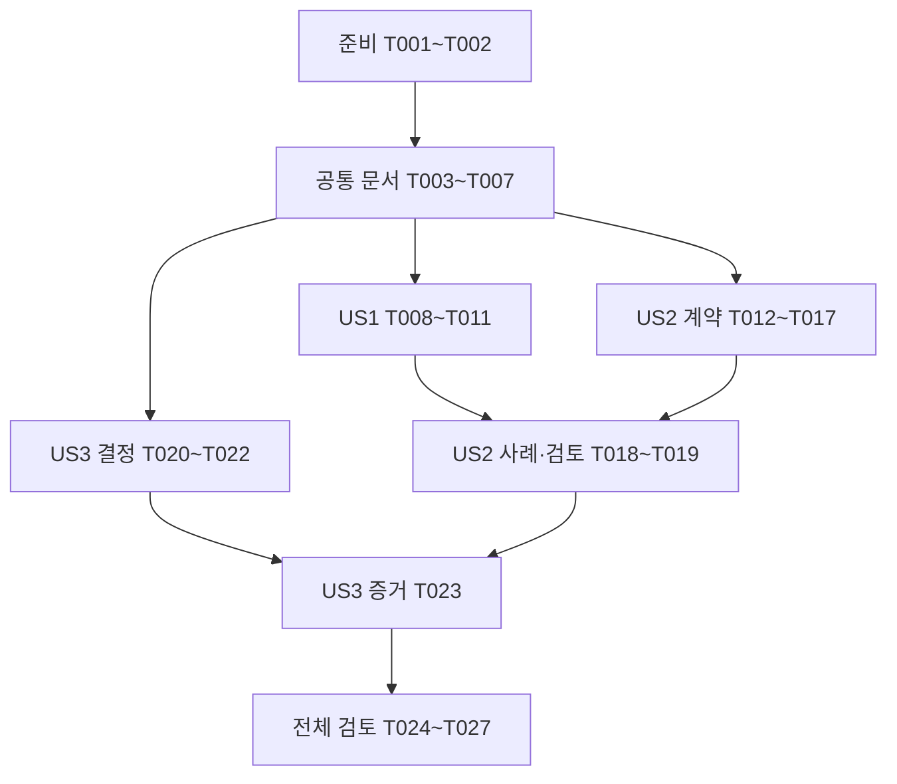

# 작업 목록: 0단계 규칙과 API 계약 확정

**입력**: [명세](spec.md), [계획](plan.md), [조사](research.md), [모델](data-model.md), [계약 설계](contracts/api-contract.md), [검토 안내](quickstart.md).
**작성일**: 2026-10-13.
**범위**: 문서·고정 API 계약 초안·수동 사례 검토. 이번 목록 생성은 작업 수행이나 0단계 완료를 뜻하지 않는다.
**검증 방식**: 명세가 요구한 수동 사례 검토와 문서 검사만 수행한다. 기능 코드·JUnit·DB·Redis·자동 OpenAPI validator 구현·실행은 후속 단계이며 이번 작업에 추가하지 않는다.

## 형식과 경로

각 작업은 `- [ ] T번호 [P 선택] [US번호 선택] 설명·파일 경로` 형식이다. `[P]`는 명시된 선행 조건 완료 후 다른 파일 작업과 병렬 실행 가능하다는 뜻이다. 스토리 단계에는 `[US1]`·`[US2]`·`[US3]`를 붙인다. 파일 경로는 저장소 루트 기준이다.

공유 파일 `docs/test-evidence.md`, `docs/openapi.yaml`, `knowledge/README.md`는 한 담당자가 순차 편집한다. 아직 없는 산출물은 아래 작업에서 만들 예정이며 링크로 존재를 가정하지 않는다. 외부 push·공개·CI 실행·배포는 포함하지 않는다.

## 1단계: 준비

**목표**: 활성 기능과 작업 위치를 확인하고 기존 변경을 보존한 문서 작업 환경을 마련한다.

- [ ] T001 `knowledge/README.md`·`knowledge/rules/` 전체·`knowledge/domain/resource.md`와 계획서 2~5절을 읽고 `git rev-parse --show-toplevel`·HEAD·현재 브랜치·상태·develop 차이를 확인한다. `.specify/feature.json`의 경로가 `specs/001-define-api-contract`인지, `specs/001-define-api-contract/plan.md`의 범위가 문서 작업인지 대조해 이번 검증 대상을 정한다.
- [ ] T002 `specs/001-define-api-contract/plan.md`의 브랜치 수행 기록과 최신 사용자 지시를 확인하고 기존 명세·지식 문서 변경의 커밋·보존 여부를 검사한다. 이미 생성된 `feature/define-api-contract`를 작업 브랜치로 사용한다. 필요한 Spec Kit·헌법 선행 커밋이 포함된 출발점이며 develop 통합은 이번 브랜치 생성·커밋 범위 밖의 후속 작업이다. 준비된 항목은 다시 수행하지 않고 상태만 확인한다. `docs/test-evidence.md`를 생성해 실제 브랜치·커밋·수행 명령·종료 코드와 API/DB/Redis/자동 계약 검증 미실행을 기록한다. 사용자 변경을 임의 포함하거나 reset·clean·강제 이력 변경으로 옮기지 않는다.

**완료 확인**: 작업 브랜치의 출처와 실제 변경 범위가 기록돼 있고 기존 변경이 보존됐다. 안내와 실제 수행 기록을 구분한다.

## 2단계: 공통 기반 문서

**목표**: 계약 작업 전에 관련 도메인의 정책·근거·미구현 상태를 기록한다. T002 이후 진행하며 T007까지 완료한 뒤 스토리 작업을 시작한다.

- [ ] T003 `knowledge/domain/resource.md`를 계획서·명세와 대조해 대상 책임·입력·수량 불변식·권한·미구현 상태를 유지한다. 이름의 “앞뒤 공백 제거 후 코드 포인트 1~100개, `😀` 1개는 1자”, capacity의 “0~1,000, 생성 후 변경하지 않음”, available의 “최초 capacity, 0~capacity”, 대상 id의 “불변, 조회 응답 필수” 제약을 확인한다.
- [ ] T004 [P] `knowledge/domain/_template.md`의 9개 절로 `knowledge/domain/reservation.md`를 작성한다. 생성·조회·취소 책임, 사용자·키당 최대 1개, 실패 키 비보존·성공 키 지속 보존, CONFIRMED→CANCELLED, resource→reservation 잠금·롤백, 최초 생성 응답과 현재 상태 차이, 검증 사례를 기록하고 구현·SQL·실행 증거는 미구현/미실행으로 표시한다.
- [ ] T005 [P] `knowledge/domain/_template.md`의 9개 절로 `knowledge/domain/security.md`를 작성한다. 로컬 Basic·고정 사용자·인증 UUID 출처, ADMIN 대상 생성, 타인 예약은 관리자도 404, 세션 없음·비밀번호 환경 변수·BCrypt·localhost 비브라우저 전제, 필터 오류·본문 제한 순서를 설계로 기록한다. 독립 업무 상태·멱등 키가 없는 항목은 이유를 적는다.
- [ ] T006 [P] `knowledge/domain/_template.md`의 9개 절로 `knowledge/domain/ratelimit.md`를 작성한다. 인증된 생성·취소 합산 20회/60초 고정 창, 재요청·입력 오류 포함, TTL 비연장, `reservation:write-limit:{userId}`, 429·Retry-After·Redis 503·업무 무변경, 조회/대상 생성의 비의존성과 미구현 상태를 기록한다.
- [ ] T007 T003~T006의 내용·근거 링크·9개 절을 확인한 뒤 `knowledge/README.md`의 도메인 목록에 reservation·security·ratelimit을 등록하고 “아직 없다”는 설명을 실제 상태에 맞게 갱신한다. `docs/test-evidence.md`에 설계 문서 작성과 구현·실행 검증의 차이를 기록한다.

**완료 확인**: 네 관련 도메인 문서와 목록이 일치하고, 계획서 정책을 구현에 맞춰 임의 변경한 내용이 없다.

## 3단계: US1 — 재시도와 취소 결과 이해 (P1, 최소 범위)

**목표**: 서버 없이 키·예약·수량의 의미를 설명할 수 있는 사례 기록을 만든다.
**독립 검증**: `docs/test-evidence.md`의 핵심 6행 흐름과 실패 키 복구·키 범위 표를 원 계획 2절과 대조한다. 매 행 수량식과 키 유일성이 성립하고 취소 복구가 최대 1회여야 한다. 본인 설명은 T025에서 별도 확인한다.

- [ ] T008 [US1] `docs/test-evidence.md`에 US1 검토 절을 만들고 capacity=1·사용자 A·미사용 K의 예약→재요청→취소→생성 재요청→조회→중복 취소를 작성한다. 각 행에 초기/최종 available·CONFIRMED 수·성공 키 기록·201/200·Location·Idempotent-Replayed·status·createdAt·cancelledAt을 적으며 `specs/001-define-api-contract/spec.md`의 기대값을 유지한다.
- [ ] T009 [US1] `docs/test-evidence.md`에 capacity=1을 B가 점유한 뒤 A/F 품절→B 취소→A/F 성공 표와 미사용 키의 400·503 후 원인 해소 재시도 사례를 작성한다. 실패 트랜잭션은 부분 반영하지 않고 키를 점유하지 않으며 커밋 후 응답 유실은 실패와 구분한다. 마지막 성공의 available=0·CONFIRMED=1·F 기록을 확인한다.
- [ ] T010 [US1] `docs/test-evidence.md`에 같은 사용자·키의 다른 대상 충돌(취소 후 포함), A의 다른 키 추가 예약, A와 B의 같은 문자열 키를 독립 초기 상태로 작성한다. 예약 필드 제약 “필수, 존재하는 대상 참조, 불변”(resourceId), “클라이언트 입력·응답 필드 아님, 불변”(userId), “사용자와 함께 유일, 1~64 ASCII 영문·숫자·밑줄·하이픈, 변환하지 않음”(idempotencyKey), id의 “불변”을 사례에 반영한다.
- [ ] T011 [US1] T008~T010 표를 대조해 `0 ≤ available ≤ capacity`, `available + CONFIRMED 예약 수 = capacity`, 성공 키당 최대 1개·예약당 취소 복구 최대 1개를 전수 확인하고 `docs/test-evidence.md`에 검토 행 수·모순 건수·수정 내용·미실행 범위를 기록한다. 상태는 “CONFIRMED 또는 CANCELLED”, 생성 시각은 “저장된 마이크로초 정밀도 값, 불변”, 취소 시각은 “CONFIRMED에서 null, CANCELLED에서 필수 시각”이며 취소 후 생성 응답은 최초 CONFIRMED를 재현해야 한다.

**완료 확인**: 수동 문서 대조의 모순 0건. 이 확인을 실제 API·경쟁·장애 테스트의 통과로 표시하지 않는다. US1만으로 규칙 이해용 최소 결과물을 제공하지만 전체 0단계는 아직 완료가 아니다.

## 4단계: US2 — 다섯 작업의 계약 판정 (P1)

**목표**: 다섯 API·DTO·오류·헤더와 정상/실패 사례를 하나의 고정 계약으로 선언한다.
**독립 검증**: `docs/openapi.yaml`과 원 계획 4절을 대조하고 각 API 정상 1개·비정상 2개 이상 총 15개 이상의 사례에 권한·입력·응답·업무 무변경/변경을 명시한다. US1 표가 없어도 독립 사례를 판정할 수 있어야 한다.

- [ ] T012 [US2] `docs/openapi.yaml`을 OpenAPI 3.0.3으로 생성해 localhost 서버, HTTP Basic security scheme과 전역 인증, 정확한 다섯 path·메서드·UUID 필수 path parameter를 선언한다. 대상 생성 ADMIN, 예약 조회·취소 소유자이며 타인 예약은 관리자도 404라는 권한을 description으로 명시한다. 코드·환경·의존성은 추가하지 않는다.
- [ ] T013 [US2] `docs/openapi.yaml`에 CreateResourceRequest·CreateReservationRequest의 required와 `additionalProperties: false`를 선언한다. name의 “앞뒤 공백 제거 후 코드 포인트 1~100개, `😀` 1개는 1자”, capacity의 “0~1,000, 생성 후 변경하지 않음”을 적용한다. 이름은 전처리 후 길이라는 description·공백 포함 100자 사례를 사용해 원문 maxLength 100으로 유효 입력을 거부하지 않는다. 예약은 필수 resourceId string/uuid만 받고 userId·quantity를 금지한다.
- [ ] T014 [US2] `docs/openapi.yaml`에 ResourceView·CreatedReservationView·ReservationView의 필수 필드를 정확히 선언한다. 대상 id·name·capacity·available과 생성 예약 id·resourceId·status·createdAt, 현재 예약의 추가 cancelledAt를 유지한다. available은 “최초 capacity, 0~capacity”, 대상 createdAt는 “저장 설계 필드, ResourceView 응답에는 포함하지 않음”이다. UUID·UTC date-time·마이크로초 설명, 생성 status enum [CONFIRMED], 현재 status enum [CONFIRMED,CANCELLED], cancelledAt 필수+string/date-time/nullable true와 상태별 null 규칙을 선언한다.
- [ ] T015 [US2] `docs/openapi.yaml`의 다섯 작업에 requestBody·성공 201/200·application/json 응답·Location을 연결한다. 예약 생성 Idempotency-Key를 필수, `^[A-Za-z0-9_-]{1,64}$`, 길이 1~64로 선언하고 변환 없음·사용자별 키 범위·대상 UUID 값 비교·취소 후 최초 응답 재현을 명시한다. Idempotent-Replayed는 최초 false·재요청 true이며 같은 id/resourceId/createdAt/status CONFIRMED·Location을 재현한다.
- [ ] T016 [US2] `docs/openapi.yaml`에 application/problem+json의 type·title·status·detail·instance·code 필수 필드와 400 INVALID_REQUEST, 401 UNAUTHENTICATED, 403 FORBIDDEN, 404 NOT_FOUND, 409 SOLD_OUT/IDEMPOTENCY_CONFLICT, 413 PAYLOAD_TOO_LARGE, 415 UNSUPPORTED_MEDIA_TYPE, 429 RATE_LIMITED, 503 DEPENDENCY_UNAVAILABLE를 각 작업에 맞게 연결한다. 401 WWW-Authenticate·429 Retry-After를 선언하며 미분류 내부 결함 500은 설명으로 남기고 임의 code나 409/503 분류를 추가하지 않는다.
- [ ] T017 [US2] `docs/openapi.yaml`에 실제 본문 8192바이트 상한·초과 413·길이 헤더 없는/chunked 요청, 두 생성의 application/json 전용·415, 취소 본문 없음·상한 이하 비어 있지 않은 본문 400, 중복 키·잘못된 JSON/UUID·capacity 문자열/소수 400을 설명한다. 크기 제한→인증→예약 쓰기 제한→입력 검증→서비스, 합산 20회/60초·TTL 비연장·Redis 503·업무 무변경·조회/대상 생성 비의존성, Retry-After 최소 1초 올림을 명시한다. 선언만으로 실행 검증하지 않았음을 적는다.
- [ ] T018 [US2] `docs/test-evidence.md`에 다섯 API의 정상 1개·비정상 2개 이상을 사례 ID와 초기 사용자·대상·수량·키·요청·성공/오류 코드·헤더·본문 필드·최종 상태로 구체화한다. 기존 US1 절을 보존하고, 추가로 😀 100개/101개·앞뒤 공백+100자·본문 8192/8193·401/429/503·타인(관리자 포함) 접근·중복 JSON 키를 명시한다. 후속 HTTP 기대값과 현재 수동 대조를 구분한다.
- [ ] T019 [US2] `docs/openapi.yaml`의 다섯 작업·스키마·필수 헤더·오류와 T018 사례를 원 계획 4절·`specs/001-define-api-contract/contracts/api-contract.md`와 전수 대조하고 `docs/test-evidence.md`에 사례 수·누락/모순 건수·검토 결과를 기록한다. 최소 15개 충족·미정 결과 0건이어야 하며 자동 YAML/OpenAPI validator와 실제 HTTP 검증은 1단계 이후 미실행으로 남긴다.

**완료 확인**: 계약 초안과 사례에서 누락·모순 0건. 스키마로 표현하지 못하는 정규화·중복 JSON 키·바이트 제한·권한·경쟁은 description과 후속 검증 항목으로 명시돼 있다.

## 5단계: US3 — 설계 선택과 한계 설명 (P2)

**목표**: 세 선택을 각각 3~5줄의 이유·대안·영향으로 기록한다.
**독립 검증**: `docs/decisions.md`의 세 항목을 조사·원 계획 3·5절과 대조한다. 서버나 OpenAPI 작성 완료 없이 판단할 수 있다. 본인 설명은 T025에서 별도 확인한다.

- [ ] T020 [P] [US3] `docs/decisions.md`를 생성해 JDBC·NamedParameterJdbcTemplate 선택을 3~5줄로 기록한다. 명시적 SQL·조건부 갱신·트랜잭션 경계를 이해하는 목적, JPA/ORM·JdbcClient 대안, 기존 Java/Gradle/패키지 유지와 미구현 상태를 포함한다. T007 후 OpenAPI 또는 US1 사례 작성과 병렬 가능하다.
- [ ] T021 [US3] `docs/decisions.md`에 성공한 예약 행에 키를 보관하는 결정을 3~5줄로 기록한다. 사용자별 키 유일성·실패 키 비보존·취소 후 성공 키 유지·최초 응답 재구성 이유와 별도 키 테이블·TTL 대안을 포함하고 아직 없는 저장/응답 코드를 검증됐다고 표현하지 않는다.
- [ ] T022 [US3] `docs/decisions.md`에 Redis를 예약 쓰기 요청 진입 제한에 사용하는 결정을 3~5줄로 기록한다. PostgreSQL 수량 원본·인증 뒤 제한·장애 시 503의 영향, 메모리/DB 카운터와 Redis 수량/분산 락 대안, 조회·대상 생성 비의존성·미실행 상태를 포함한다.
- [ ] T023 [US3] `docs/decisions.md`의 세 기록을 `specs/001-define-api-contract/research.md`와 대조해 각각 3~5줄·이유·대안·영향을 확인하고 `docs/test-evidence.md`에 결과를 기록한다. 실패 키 재사용과 취소 후 최초 응답 재현 설명이 기록과 모순되지 않는지 확인한다. 공유 증거 파일 편집은 T019 뒤 진행한다.

**완료 확인**: 세 결정의 문서 검토가 통과하고, 기술 선택 이유와 업무 규칙을 구분한다. 사용자의 설명 능력은 대리 작성만으로 통과 처리하지 않는다.

## 6단계: 정리와 전체 검토

**목표**: 산출물의 동기화·실제 검증 증거·본인 설명 여부를 확인한다. US1~US3의 문서 검토 이후 진행한다.

- [ ] T024 `knowledge/README.md`와 관련 도메인 문서에 실제 생성된 `docs/openapi.yaml`·`docs/decisions.md`·`docs/test-evidence.md` 링크를 연결하고 작성 예정/실제 문서 상태를 갱신한다. `specs/001-define-api-contract/spec.md`·`plan.md`·`contracts/api-contract.md`와 정책을 대조하되 설계 문서의 작성 당시 기록은 유지하고 코드·SQL·실행 검증 미완료를 지우지 않는다.
- [ ] T025 `docs/test-evidence.md`의 사례·결정 기록을 준비한 뒤 사용자에게 키 재사용·실패 키·다른 키 추가 예약·취소 후 재시도 및 세 선택 이유를 자기 말로 설명하도록 확인한다. 실제 설명에서 수량·상태·키에 모순이 없으면 그 결과를 기록한다. 답변이 없거나 설명을 확인하지 못하면 이 작업은 미완료로 유지하고 본인 설명 미검증을 명시하며 독립 문서 검사는 계속한다.
- [ ] T026 `specs/001-define-api-contract/quickstart.md`의 현재 문서 검사와 후속 산출물 존재 확인 명령을 실행하고 새 도메인/최종 문서의 상대 링크·공백·필수 계약 항목도 검사해 `docs/test-evidence.md`에 실제 명령·종료 코드·문서/사례 수·환경·미검증 범위를 기록한다. `specs/001-define-api-contract/checklists/requirements.md`는 요구사항 품질로 재평가하며 실행 완료 표식으로 바꾸지 않는다.
- [ ] T027 `한정 수량 예약 백엔드 로컬 개발 계획.md`의 0단계 항목을 증거와 대조해 실제 충족한 것만 표시하고 `docs/test-evidence.md`에 변경 이유·검증 결과·남은 범위·읽을 문서·다음 한 작업을 기록한다. T025 미완료이면 설명 체크와 0단계 전체 완료는 표시하지 않는다. 문서 검사 통과 후 목적별 로컬 커밋을 작성하고 실제 수행 결과·남은 변경을 확인한다. 다음 작업은 1단계 최소 테스트 도구 준비이며 API/DB/Redis/자동 계약 검증/외부 CI는 완료했다고 쓰지 않는다.

## 의존 관계와 실행 순서

- T001→T002 후 T003·T004·T005·T006은 파일이 달라 독립 진행 가능하며 T007은 네 문서 검토 완료에 의존한다.
- US1 T008→T009→T010→T011은 같은 증거 파일이므로 순차다.
- US2 T012→T013→T014→T015→T016→T017은 같은 OpenAPI 파일이므로 순차다. T018→T019는 공유 증거 파일 충돌을 피하려고 T011과 T017 이후에 배치한다. 이는 파일 편집 순서이며 US2의 업무 계약이 US1 산출물에만 의존한다는 뜻은 아니다.
- US3 T020→T021→T022는 같은 결정 파일이므로 순차다. T023은 T022와 T019 이후다.
- 전체 검토는 T024 이후 T025·T026을 수행하고 T027로 결과를 정리한다. T025 답변 대기 중 T026은 진행할 수 있으나 T025 체크를 자동 완료하지 않는다. T027의 완료 상태는 부분 완료·본인 설명 미검증을 정확히 반영한 기록도 허용하며 전체 0단계 완료를 뜻하지 않는다.

## 병렬 실행 예시

| 스토리 | 병렬 가능한 예 | 순차로 유지할 작업 |
| --- | --- | --- |
| US1 | T007 뒤 US1 사례 파일(T008~T011) 작성과 US2 OpenAPI(T012~T017) 또는 US3 결정(T020~T022) 작성 | US1 증거 파일 내부 행 추가·검토 |
| US2 | OpenAPI 담당자가 T012~T017, 결정 담당자가 T020~T022 수행 | OpenAPI 한 파일 변경·T018 이후 공유 증거 기록 |
| US3 | T020부터 결정 파일 작성과 US1 사례 또는 US2 OpenAPI 작성 | 세 결정의 같은 파일 편집·T023 결과 기록 |

공통 기반에서 `[P]` 작업 T004·T005·T006은 각 도메인 파일을 따로 작성하며 목록 등록은 T007에서 한 번에 처리한다. 위 예시는 가능성 안내이며 병렬 실행·에이전트 위임을 이번 명령에서 수행했다는 기록이 아니다. 기본 실행은 한 검증 대상씩 순차 진행한다.

## 구현 전략

1. 준비·기반 완료 뒤 US1 사례와 수동 수량 대조를 먼저 완성한다. 규칙 이해용 최소 결과물이지만 전체 0단계 완료나 API 구현 완료는 아니다.
2. US2를 더해 계약·입력·권한·오류·헤더를 고정한다. 원 계획의 정상 5개·비정상 10개 이상을 확인한다.
3. US3의 세 결정 기록을 더하고 각 스토리의 독립 검토 결과를 확인한다.
4. 산출물·링크·실제 검증 증거와 사용자 설명을 확인한다. 설명이 미확인이라도 독립 문서 작업과 기록은 끝내며 미완료 항목은 그대로 남긴다.
5. 실행된 작업만 체크하고 논리적으로 완료된 검증 대상별 작은 커밋을 남긴다. 기본 절차에 앱 빌드·컨테이너·부하·배포를 추가하지 않는다.

## 요구사항 추적

| 요구사항·성공 기준 | 작업 |
| --- | --- |
| FR-001 범위·SC-006 상태 구분 | T001~T002, T024~T027 |
| FR-002 키 의미·FR-003 불변식·SC-002·SC-003 | T008~T011, T025 |
| FR-004 사례·SC-001 | T018~T019 |
| FR-005 재현 | T008, T011, T015, T019 |
| FR-006 OpenAPI·FR-011 권한·SC-004 | T012, T015~T019 |
| FR-007 스키마·FR-008 응답 | T013~T014 |
| FR-009 엄격 입력 | T013, T017~T019 |
| FR-010 오류 | T016, T019 |
| FR-012 요청 제한 | T006, T017~T019 |
| FR-013 결정·SC-005 | T020~T023, T025 |
| FR-014 수동 대조·자동 검증 분리 | T011, T019, T026~T027 |

## 집계와 주의사항

총 27개: 준비 2, 기반 5, US1 4, US2 8, US3 4, 전체 검토 4. `[P]` 4개(T004·T005·T006·T020). 모든 작업은 미완료로 생성했다. 작업 목록 작성·형식 검사는 실제 계약 작성이나 작업 실행의 증거가 아니다.
