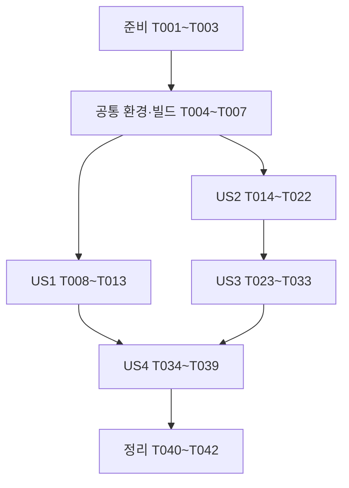

# 작업 목록: 1단계 환경과 테스트 도구 최소 실행 검증

**입력**: `specs/002-setup-test-toolchain/`의 [명세](spec.md), [계획](plan.md), [조사](research.md), [데이터 모델](data-model.md), [실행 계약](contracts/validation-contract.md), [검증 안내](quickstart.md).
**작성일**: 2026-10-13
**현재 문서 브랜치**: `docs/setup-test-toolchain`
**상태**: 구현 착수. T001~T003 준비 완료; 나머지 실제 검증 결과에 따라 갱신한다.

**테스트 포함 근거**: 명세가 기본·연동·속성·변이·실제 HTTP 계약의 최소 실행과 실패 탐지를 명시적으로 요구한다. 순수 동작은 테스트 → 동작 실패 → 최소 구현 → 관련 재검증 순서다. 환경·도구 설정은 최소 실행으로 검증하며 준비 부족·컴파일 오류를 기능 실패로 계산하지 않는다.
**구성**: 준비 → 공통 기반 → US1~US4 → 정리. 각 단계 완료는 실제 근거로 판정하고 기록한다.

## 형식과 경로

- 작업은 `- [ ] T번호 [P 선택] [US번호 선택] 설명과 경로` 형식이다.
- `[P]`는 명시된 선행 작업이 완료된 뒤 서로 다른 파일의 준비·구현을 병행할 수 있다는 뜻이다. 테스트 클래스 병렬 실행이나 에이전트 자동 위임을 뜻하지 않는다.
- 코드 경로는 프로젝트 루트 기준이며 Gradle 명령은 `backend/`에서 실행한다. Compose와 `docs/`는 프로젝트 루트 기준이다.
- 아직 없는 파일·태스크는 해당 작업에서 구현할 예정이다. 전체 구현을 이 문서 생성으로 완료 표시하지 않는다.
- [도구 요구사항 체크리스트](checklists/toolchain.md)는 검토자 소유로 검토 결과 30/30 통과 상태다. 이번 명령은 항목을 평가하거나 체크하지 않는다. 후속 구현의 체크리스트 진행 조건과 작업 생성은 구분한다.
- 이 단계는 새 업무 도메인을 개발하지 않는다. 정수 프로브는 무해한 도구 확인용이고 업무 수량 범위는 기존 `knowledge/domain/resource.md`를 유지한다.

## 1단계: 작업 준비

**목적**: 기준·작업 상태·미검토 체크리스트를 확인한다. 새 저장소를 만들거나 기능 구현을 시작하지 않는다.

- [X] T001 저장소 최상위·HEAD·브랜치·기존 변경과 기존 Gradle 골격을 재확인하고 `docs/test-evidence.md`에 착수 기준을 기록한다. `knowledge/README.md`, 규칙 전체, `specs/002-setup-test-toolchain/spec.md`와 `plan.md`를 대조한다. 실제 구현 착수 시 `develop` 기반 `chore/setup-test-toolchain` 작업 브랜치를 준비하되 현재 미커밋 설계·사용자 변경을 보존하고 수행 기록을 구분한다. (선행: 없음)
- [X] T002 `specs/002-setup-test-toolchain/checklists/toolchain.md`의 검토자 소유·미검토 상태와 `checklists/requirements.md`의 별도 수명주기를 `docs/test-evidence.md`에 구분해 기록한다. 사용자 검토 요청 없이 항목을 평가하거나 표시를 바꾸지 않으며, 구현 전 미검토 항목은 별도 검토 조건으로 남긴다. (선행: T001)
- [X] T003 `docs/versions.md`에 환경 목록·조합 상태의 기록 틀을 만들고 `docs/decisions.md`와 `docs/test-evidence.md`의 기존 내용을 보존해 1단계 기록 구역을 준비한다. “후보 → 설치/취득됨 → 버전 확인됨 → 해당 최소 사례 실행 확인됨”을 사용하고 비밀값을 기록하지 않는다. (선행: T001)

## 2단계: 공통 기반

**목적**: 모든 스토리에 필요한 빌드 의존성과 검증 설정을 준비한다. 이 단계만으로 어떤 테스트 범위도 성공으로 표시하지 않는다.

- [X] T004 JDK 배포판·패치, 실제 Wrapper, Docker·Compose·k6 존재/버전, CPU와 Docker 메모리를 확인하고 부족한 도구만 준비해 `docs/versions.md`에 기록한다. 조사 후보 이미지의 exact tag·아키텍처·취득 digest를 확인하고 Compose/Testcontainers 공통 식별값을 `docs/decisions.md`에 정한다. 설치·문서 조사·실행 확인을 구분한다. (선행: T003)
- [X] T005 `backend/build.gradle`에 계획의 MVC·Validation·Security·JDBC·Redis·Flyway·Actuator, PostgreSQL driver·Flyway PostgreSQL 모듈과 필요한 테스트 starter·Testcontainers 2 좌표를 추가한다. Java 25·Boot 4.1.1·Wrapper 9.7.1을 유지하고 BOM 관리 버전은 override하지 않는다. 실제 dependencyInsight 결과를 `docs/versions.md`에 기록하며 취득 실패는 원인별로 분리한다. (선행: T003·T004)
- [X] T006 `backend/build.gradle`에 `test`, `integrationTest`, `contractTest`, `propertyTest`의 이름·태그·classpath·보고서 분리 설정을 작성하고 `backend/src/test/resources/junit-platform.properties`에 클래스 순차 실행을 설정한다. fork1·UTF-8/UTC, contract/property 포함·제외는 `specs/002-setup-test-toolchain/contracts/validation-contract.md`를 따른다. 아직 사례가 없는 범위를 성공 처리하지 않는다. (선행: T005)
- [X] T007 기존 `backend/src/test/java/com/limitedbooking/backend/BackendApplicationTests.java`의 Spring 기동 검사 의도를 보존해 `backend/src/test/java/com/limitedbooking/backend/BackendApplicationIT.java`로 분류를 이동한다. 동적 실제 컨테이너 연결은 US2에서 보완하며 순수 Unit에 Spring 기동이 섞이지 않게 한다. (선행: T006)

## 3단계: US1 — 기존 작업 공간에서 실행 준비 상태 확인 (P1, MVP)

**목적**: 필요한 환경과 로컬 기동·종료·PostgreSQL 보존을 재현한다.

**독립 인수 기준**: 앱·두 서비스의 로컬 기동과 종료, PostgreSQL 표식 저장·commit·컨테이너 재생성 후 동일 값 조회를 확인한다. Redis 키의 재시작 후 보존과 업무 예약 기능은 인수 대상이 아니다.

- [X] T008 [P] [US1] 프로젝트 루트 `compose.yaml`을 작성한다. postgres 서비스는 127.0.0.1:5432·reservation_local·named volume `/var/lib/postgresql`, redis는 127.0.0.1:6379로 구성하고 선정된 정확한 이미지를 고정한다. UTF-8/UTC·비밀값 환경 주입·healthcheck·준비 대기120초 설정을 두고 기본 종료에 볼륨 삭제를 넣지 않는다. (선행: T004)
- [X] T009 [P] [US1] `backend/src/main/resources/application-local.yaml`을 작성한다. 앱 127.0.0.1:8080, 로컬 DB·Redis, 환경 변수 비밀번호, health만 노출·상세 비노출, 기동 확인용 toolchain 계정을 설정한다. `backend/src/main/java/com/limitedbooking/backend/BackendApplication.java`와 기본 패키지는 유지하고 업무 UUID 인증·임시 업무 경로·전체 허용 보안 설정을 추가하지 않는다. (선행: T004)
- [X] T010 [P] [US1] 루트 `.env.example`에는 POSTGRES_USER·POSTGRES_PASSWORD·TOOLCHAIN_SMOKE_PASSWORD 등 실제 필요한 변수명만 제공하고 `.gitignore`와 `backend/.gitignore`에서 개인 `.env`·로그·데이터·캐시 제외를 선별한다. Compose 보간과 호스트 JVM 별도 주입을 `README.md`에 안내한다. (선행: T004)
- [X] T011 [US1] `README.md`의 환경 안내에 따라 Compose와 local 앱의 최소 기동·health·정상 종료를 수행하고 `docs/test-evidence.md`에 명령·종료 코드·주소·확인 상태를 남긴다. 서비스 미준비·비밀값 누락의 최소 실패도 구분하고 정상 설정으로 복구한다. Compose 준비120초·앱 준비60초·HTTP 연결3초/요청10초 상한과 초과 시 실패 종료·미검증 판정을 기록한다. (선행: T008·T009·T010)
- [X] T012 [US1] `README.md`에 보존 표식의 준비·조회·본인 표식만 정리하는 실제 명령을 추가한다. `toolchain_smoke` 시험 schema의 UUID·정수1행을 commit하고 기본 down(볼륨 유지)·up 후 동일 값 보존을 확인해 `docs/test-evidence.md`에 기록한다. 개발 업무 데이터는 초기화하지 않으며 Redis 영속화는 요구하지 않는다. 준비 트랜잭션 실패/commit 응답 유실/재시작 중단의 상태 대조·담당자 정리·재개 조건은 `specs/002-setup-test-toolchain/contracts/validation-contract.md`의 복구 계약대로 실제 안내와 증거에 반영한다. (선행: T011)
- [X] T013 [US1] US1의 도구 목록·local 기동·실패 복구·보존 근거를 `docs/versions.md`와 `docs/test-evidence.md`에서 대조하고 환경 설정 변경만 검증 단위의 로컬 커밋으로 남긴다. 미실행 심화 도구는 미검증으로 유지한다. (선행: T012)

## 4단계: US2 — 기본 검증과 실제 저장소 연동 (P1)

**목적**: 순수 기본 사례와 실제 PostgreSQL/Redis·Flyway·앱 연동을 발견·검증한다.

**독립 인수 기준**: 순수 Unit과 각 저장소 연동 최소1건, 실패0·skip0, 지정 사례 발견·고의 값 불일치 비성공 종료와 원복 후 성공을 판정한다. 개발 DB 없이 동적 컨테이너에서 수행한다.

- [X] T014 [US2] `backend/src/test/java/com/limitedbooking/backend/common/ToolchainSmokeTest.java`에 정수 저장·조회와0/100 사례를 먼저 작성하고 `backend/src/main/java/com/limitedbooking/backend/common/ToolchainProbe.java`는 컴파일 가능한 최소 골격까지만 둔다. “입력: 정수 0~100”과 저장값 일치 assertion의 동작 실패를 실제로 확인해 `docs/test-evidence.md`에 기록한다. 컴파일 오류를 실패 증거로 계산하지 않는다. (선행: T007)
- [X] T015 [US2] `backend/src/main/java/com/limitedbooking/backend/common/ToolchainProbe.java`에 무해한 순수 저장·조회 최소 동작을 구현한다. Bean·API·업무 capacity 규칙을 추가하지 않고 각 입력은 새 상태로 검증한다. `backend/src/test/java/com/limitedbooking/backend/common/ToolchainSmokeTest.java`의 기본·지정 실행을 통과시켜 `docs/test-evidence.md`에 실제 수와 종료 코드를 기록한다. (선행: T014)
- [X] T016 [P] [US2] `backend/src/test/java/com/limitedbooking/backend/common/ToolchainSmokeIT.java`에 실제 PostgreSQL 적용 메타데이터·insert/select와 Redis set/get의 독립 assertion을 먼저 작성한다. 시험 데이터의 “`id` UUID 기본키, `value` 정수”와 Redis `toolchain:smoke:<UUID>`를 사용한다. 기반 미준비 실패와 값 불일치 실패는 구분하며, 아직 없는 지원 클래스로 인한 컴파일 오류를 동작 검증으로 기록하지 않는다. (선행: T015)
- [X] T017 [P] [US2] `backend/src/test/java/com/limitedbooking/backend/support/ContainerTestSupport.java`에 실제 PostgreSQLContainer·Redis GenericContainer 수명주기와 host/mapped port 연결값을 준비한다. 공통 기반에서 선정한 이미지 식별값을 재사용하고 local 프로필·고정 개발 접속값을 fallback으로 쓰지 않는다. 테스트 전용 DB/키와 정리 범위, startup 120초·종료10초 상한을 명시한다. (선행: T015·T004)
- [X] T018 [US2] `backend/src/test/resources/db/toolchain/V1__toolchain_probe.sql`에 “`id` UUID 기본키, `value` 정수”의 작은 시험 테이블 migration을 작성한다. `backend/src/test/java/com/limitedbooking/backend/common/ToolchainSmokeIT.java`에서 Flyway 전용 위치·실제 적용 버전·삽입값 조회·Redis 값 일치를 확인하고 연결/클라이언트/시험 데이터 종료 처리를 구현한다. 업무 migration 경로에 시험 테이블을 넣지 않는다. 시험 전용 실패 migration의 예외·metadata 조회 가능 여부·자원 정리와 원인 수정 후 새 격리 DB 정상 재개를 별도 사례로 확인한다. 지원 코드가 이번 시험 자원만 정리하고 잔존 상태·담당·재개 근거를 `docs/test-evidence.md`에 기록한다. 실패 DB 자동 repair/clean·개발 DB 초기화는 사용하지 않는다. (선행: T016·T017)
- [X] T019 [US2] `backend/src/test/java/com/limitedbooking/backend/BackendApplicationIT.java`에 컨테이너의 동적 DB/Redis 연결·시험용 migration 위치·테스트 중 생성한 비밀값·RANDOM_PORT를 공급한다. 기존 contextLoads 의도와 실제 앱 HTTP health를 검사하며 업무 인증 성공으로 확대하지 않는다. (선행: T017·T018)
- [X] T020 [US2] `backend/build.gradle`에서 `verify=Unit+일반 IT`를 연결하고 현재 suite 결과를 수집하는 검증을 추가한다. 필수 그룹별 “실행≥1, 실패0, skipped0”, NO-SOURCE·결과 없음·보고서 없음·이전 결과 재사용의 판정을 구현하고 failOnNoDiscoveredTests/failOnNoMatchingTests만으로 완료를 대신하지 않는다. (선행: T015·T018·T019)
- [X] T021 [US2] `backend/src/test/java/com/limitedbooking/backend/common/ToolchainSmokeTest.java`, `backend/src/test/java/com/limitedbooking/backend/common/ToolchainSmokeIT.java`와 `backend/build.gradle`의 한 대상씩 값 불일치·이름 불일치·전체 태그 제외·고의 skip을 일시 주입한다. `docs/test-evidence.md`에 비성공 종료와 원인을 기록하고 각 변경을 원복한 뒤 기본/verify/지정 IT의 새 실행 수를 확인한다. 실패 후 오래된 보고서로 통과시키지 않는다. (선행: T020)
- [X] T022 [US2] Unit·PG·Redis·Flyway·앱 IT의 검증된 조합과 실제 발견·지정 실행·원복 결과를 `docs/versions.md`와 `docs/test-evidence.md`에 정리하고 관련 변경을 목적별 로컬 커밋으로 남긴다. (선행: T021)

## 5단계: US3 — 심화 도구의 실패 탐지 (P2)

**목적**: 작은 사례에서 변이 생성·탐지, 속성 실패 축소·seed 재현, 실제 HTTP 계약 위반 탐지를 입증한다.

**독립 인수 기준**: PIT 생성/탐지 각1개 이상·NO_COVERAGE0, 속성 정상/경계결함/축소/동일seed재실패/원복, 계약 정상 허용·id 누락 거부·기존 문서 읽기 근거를 각각 독립 판정한다.

- [X] T023 [US3] `backend/build.gradle`에 QuickTheories0.26과 validator core2.46.1, PIT plugin1.19.0/engine1.22.1/Jupiter지원1.2.3의 조사 후보를 명시적으로 고정한다. 실제 해석을 `docs/versions.md`에 기록하고 incompatibility는 `research.md`의 대안을 원인별로 평가해 `docs/decisions.md`에 남긴다. BOM의 JUnit/Platform을 임의로 낮추지 않는다. (선행: T022)
- [X] T024 [P] [US3] `backend/src/test/java/com/limitedbooking/backend/common/ToolchainPropertyTest.java`에 property 태그의 순수 정수 사례를 먼저 작성한다. “입력: 정수 0~100”, “정상 0과100, 생성 입력 최소100회”, 매 입력 새 상태, 원래 입력을 기대값으로 삼는 assertion을 고정한다. 생성 시도 수와 JUnit 사례 수를 별도 출력할 준비를 한다. 선행 작업에서 추가한 라이브러리로 컴파일 가능한 테스트를 작성한다. (선행: T023)
- [X] T025 [P] [US3] `backend/src/test/java/com/limitedbooking/backend/common/ToolchainContractIT.java`에 contract 태그의 실제 HTTP 정상/id제거 음성 사례와 루트 `docs/openapi.yaml`의 파싱·참조 처리 사례를 먼저 작성한다. `specs/002-setup-test-toolchain/contracts/toolchain-smoke.openapi.yaml`의 “id 필수·string·uuid·additionalProperties:false”를 기대 계약으로 고정하고 아직 없는 fixture의 컴파일 실패를 동작 실패로 주장하지 않으며 해당 파일의 보조 클래스는 다음 작업에서 준비한 뒤 공유 컴파일을 검사한다. (선행: T023)
- [X] T026 [P] [US3] `backend/src/test/java/com/limitedbooking/backend/support/ToolchainHttpFixture.java`에 테스트 전용 loopback 동적 포트 HTTP 서버를 구현한다. 같은 GET 경로에 정상 “200 JSON에 유효 UUID id”와 음성 “200 JSON에서 id를 제거” 모드를 내부 설정으로 제공하고 연결3초·요청10초·종료10초 상한을 적용한다. 제품 Controller·공개 장애 파라미터를 만들지 않는다. (선행: T025)
- [X] T027 [P] [US3] `backend/src/test/java/com/limitedbooking/backend/support/ToolchainContractValidator.java`에 실제 method/path/headers/body/status를 core 요청·응답으로 변환하는 최소 어댑터를 구현한다. 정상은 검증 오류0, 음성은 오류 존재를 반환하며 parser 오류·미해결 참조를 삼키지 않는다. (선행: T025)
- [X] T028 [US3] `backend/build.gradle`의 테스트 리소스 처리에 `specs/002-setup-test-toolchain/contracts/toolchain-smoke.openapi.yaml`과 루트 `docs/openapi.yaml`을 연결한다. 원본을 수작업 중복 관리하지 않으며 계약 fixture와 기존 업무 계약 리소스 이름을 분리한다. `backend/src/test/java/com/limitedbooking/backend/common/ToolchainContractIT.java`의 실제 JDK HTTP 요청을 fixture·어댑터와 연결한다. (선행: T025·T026·T027)
- [X] T029 [US3] `backend/build.gradle`에 `propertyTest`의 명시적 classpath·property 태그·QT_SEED JVM 전달과 속성 보고를 연결한다. `backend/src/test/java/com/limitedbooking/backend/common/ToolchainPropertyTest.java`에 선택 후보 API를 적용해 공유 test source set 전체의 compileTestJava 성공을 먼저 확인한 뒤 정상 경계·생성최소100회를 통과시키고 실제 seed/시도 수를 `docs/test-evidence.md`에 기록한다. (선행: T024·T028)
- [X] T030 [US3] `backend/src/main/java/com/limitedbooking/backend/common/ToolchainProbe.java`에 “n>50에서 다른 값을 보관한다”는 일시 결함을 주입해 `backend/src/test/java/com/limitedbooking/backend/common/ToolchainPropertyTest.java`의 비성공 종료를 확인한다. 최초 반례>51·축소 반례51·seed를 `docs/test-evidence.md`에 기록하고 같은 seed로 같은 실패를 재현한다. 처음부터51인 결과만으로 축소를 완료하지 않으며 원복·정상 재검증·diff 확인까지 수행한다. (선행: T029)
- [X] T031 [US3] `backend/build.gradle`에 ToolchainProbe/ToolchainSmokeTest만 대상으로 PIT와 `mutationSmoke` 결과 판정을 구성한다. XML/HTML의 “생성≥1·killed≥1·NO_COVERAGE0”, 보고서 누락·도구 예외·0개 결과 실패를 처리하고 생존 이유를 `docs/test-evidence.md`에 기록한다. 업무 규칙80%·SQL/권한 검증은 이 결과로 대신하지 않는다. (선행: T030)
- [X] T032 [US3] `backend/src/test/java/com/limitedbooking/backend/common/ToolchainContractIT.java`에서 정상 허용·필수id 누락 거부·기존 명세 읽기 사례의 실제 실행 수와 판정을 `docs/test-evidence.md`에 남긴다. 정상이라 주장한 응답을 일시 훼손해 비성공 종료를 확인하고 원복 후 통과시킨다. 예상 거부를 assertion으로 확인하는 음성 사례 성공과 고의 실패 시연을 구분한다. (선행: T031·T028)
- [X] T033 [US3] US3의 후보→실행 확인 근거, 속성 축소·재현·원복, PIT 결과, 실제 fixture HTTP·문서 읽기의 보장 한계를 `docs/versions.md`, `docs/decisions.md`, `docs/test-evidence.md`에 정리하고 검증된 변경을 목적별 로컬 커밋으로 남긴다. (선행: T032)

## 6단계: US4 — 실행 범위·근거와 다음 단계 인수 (P2)

**목적**: 모든 정의된 실행 범위와 결과 기록을 대조해 실제 1단계 완료 여부를 판정한다.

**독립 인수 기준**: 실행 안내·보고서·증거를 대조해 각 범위의 발견 대상/수/종료 코드, 고의 실패 및 원복, 미검증·호환 상태를 판정한다. US1~US3의 개별 성공을 자동으로 전체 성공으로 취급하지 않는다.

- [ ] T034 [US4] `backend/build.gradle`에 verifyContract=verify+Contract, verifyProperty=verify+Property, deepTest=Unit+일반IT+Contract+Property를 연결하고 PIT의 별도 실행을 유지한다. `specs/002-setup-test-toolchain/contracts/validation-contract.md`와 포함·제외·그룹별 결과 검증·지정 IT 옵션 전달을 대조한다. (선행: T033·T013)
- [ ] T035 [US4] `README.md`와 `specs/002-setup-test-toolchain/quickstart.md`의 모든 정의된 범위를 실제 구현한 태스크로 실행해 그룹별 사례 수·종료 코드·현재 실행 여부를 `docs/test-evidence.md`에 기록한다. 최초 증거는 --rerun-tasks를 사용하며 새 변경 없는 무거운 범위는 불필요하게 반복하지 않는다. cache 재사용은 새 실행으로 표기하지 않는다. (선행: T034)
- [ ] T036 [US4] `backend/build.gradle`의 Contract/Property 선택에도 0건·고의 skip·잘못된 filter·고의 실패가 비성공으로 드러나는지 한 설정씩 시연한다. `docs/test-evidence.md`에 실패와 원복 후 해당 범위 재검증을 기록하고 이미 US2에서 입증한 동일 기본 사례는 불필요하게 재시연하지 않는다. (선행: T035)
- [ ] T037 [P] [US4] `docs/versions.md`에서 실제 JDK·Wrapper·BOM 해석·Testcontainers·이미지 tag/digest·PIT/속성/계약 조합을 각 실행 증거와 연결한다. 후보·개별 성공·전체 최소 조합 성공을 구분하고 미검증·확인 불가 이유를 보존한다. (선행: T036)
- [ ] T038 [P] [US4] `README.md`에 host JVM 환경 별도 주입·local 기동/종료·보존·IT 격리·분류별 명령/보고서·seed재현·고의 결함 원복·심화 범위·PIT 별도 판정을 실제 상태로 정리한다. `.env` 값이나 비밀번호·환경 전체 덤프를 포함하지 않는다. (선행: T036)
- [ ] T039 [US4] `docs/test-evidence.md`에 FR-001~FR-014 및 SC-001~SC-006별 근거·미완료·원복 확인·다음 한 작업을 연결해 US4 인수 표를 작성한다. “필수 그룹0건·실패·skip·원복 누락은0, 필수 증거가 모두 존재한다”를 적용하며 하나라도 미충족이면 1단계 전체 완료를 보류한다. (선행: T037·T038)

## 7단계: 정리·문서 동기화

**목적**: 실행 확인한 상태와 설계 문서를 일치시키고 검증된 작업을 로컬 이력으로 남긴다.

- [ ] T040 `한정 수량 예약 백엔드 로컬 개발 계획.md`의3·6·7절과 `knowledge/README.md`, `knowledge/rules/architecture.md`, `knowledge/rules/development-and-testing.md`, `knowledge/rules/environment-and-records.md`를 실제 Gradle·파일·명령·검증 상태와 맞춘다. 업무2~5절·고정 API 계약은 변경하지 않으며 1단계 완료 표시는 T039의 실제 인수 결과로만 결정한다. (선행: T039)
- [ ] T041 `specs/002-setup-test-toolchain/plan.md`, `quickstart.md`와 `docs/decisions.md`에 실제 채택 도구·실패 원인·선택 변경·남은 한계 및 프로브를 후속 실제 규칙으로 대체할 위치를 반영한다. 문서 링크·형식·범위와 고의 결함·임시 설정 잔존을 검사한다. `checklists/toolchain.md` 검토 표시를 대신 변경하지 않는다. (선행: T040)
- [ ] T042 `docs/test-evidence.md`에 최종 대상 commit/작업 트리·문서 검사·필수 결과·미검증 범위를 기록하고 `knowledge/rules/commit.md`·`git-flow.md`에 따라 관련 경로만 선별한 목적별 로컬 커밋을 남긴다. 실제 변경이 있으면 영향 범위만 재검증하며 외부 push·workflow·병합·태그는 이번 작업에서 수행하지 않는다. (선행: T041)

## 의존성과 실행 순서

공통 기반에서 환경·이미지 확인과 빌드 구성을 마친 뒤 US1과 US2를 각각 시작할 수 있다. US3은 라이브러리 준비 → 사례 작성 → 계약 보조 클래스와 리소스 연결 → 공유 컴파일 → 속성·변이·계약 검증 순서다. 단일 작업자 기본 순서는 단계와 작업 번호 순서다.

**스토리 내부 주요 사슬**:

- US1: T008/T009/T010 → T011 → T012 → T013. 모두 공통 환경 확인 T004를 선행한다.
- US2: T014 → T015 → T016/T017 → T018 → T019 → T020 → T021 → T022. T017은 공통 이미지 선정 T004도 필요하다.
- US3: T023 → T024/T025 → T026/T027 → T028 → T029 → T030 → T031 → T032 → T033. T029는 T024도 선행한다.
- US4: T034 → T035 → T036 → T037/T038 → T039.
- 각 작업의 선행 목록이 최종 기준이다. 공유 파일 수정·실패 주입·원복·실행 증거 취합은 순차 수행한다.

## 병행 작업 예시

| 스토리 | 선행 완료 후 병행 가능한 작업 | 병행하지 않는 작업 |
| --- | --- | --- |
| US1 | T004 후 T008 Compose · T009 local 설정 · T010 환경 예시/안내 | T011 기동과 T012 보존은 준비 완료 뒤 순차 |
| US2 | T015/T004 후 T016 연동 assertion 작성 · T017 컨테이너 지원 | T018 연결/마이그레이션·T020 빌드 결과 판정·T021 고의 결함 |
| US3 | T023 후 T024 속성 사례 · T025 계약 사례; T025 후 T026 HTTP fixture · T027 validator 어댑터 | T023/T028/T029/T031의 build.gradle 수정과 T030 프로브 결함·원복 |
| US4 | T036 후 T037 버전 기록 · T038 README | T035/T036 실제 실행 및 T039 최종 증거 취합 |

병행 표는 작업 분해의 가능성을 나타낸다. 실제 구현은 한 검증 대상씩 `superpowers:executing-plans`로 진행할 수 있으며, 위임이 명시적으로 선택되면 파일 책임과 공유 부분의 순서를 먼저 정한다. 이번 명령은 실행 에이전트를 시작하지 않는다.

## 요구사항·성공 기준 추적

| 요구사항 | 주 작업 |
| --- | --- |
| FR-001 | T001·T004 |
| FR-002 | T004·T037 |
| FR-003 | T008·T009·T011·T012 |
| FR-004 | T009·T010·T038 |
| FR-005 | T014·T015 |
| FR-006 | T016~T019 |
| FR-007 | T023·T031 |
| FR-008 | T024·T029·T030 |
| FR-009 | T006·T020·T034·T035 |
| FR-010 | T011·T020·T021·T031·T036 |
| FR-011 | T014·T021·T030·T032·T036 |
| FR-012 | T025·T026·T027·T028·T032 |
| FR-013 | T003·T004·T022·T033·T037·T039 |
| FR-014 | T013·T022·T033·T039~T042 |

SC-001은 T004/T011/T012, SC-002는 T015/T018/T019/T022, SC-003은 T030/T031, SC-004는 T032, SC-005는 T021/T035/T036, SC-006은 T037~T039의 근거로 판정한다. 숫자는 작업 식별자이며 현재 성공 결과가 아니다.

## 구현 전략

1. **최소 인수 범위**: 준비·공통 기반과 US1(T008~T013)까지 진행한다. 기존 저장소·로컬 환경·PostgreSQL 보존을 재현하는 MVP이며 전체 테스트 도구 준비 완료를 뜻하지 않는다.
2. **점진적 확장**: US2에서 기본·실제 연동을 추가하고 US3의 PIT·Property·Contract를 하나씩 확인한다. 실패 시 그 검증 대상의 원인을 분리한 뒤 조정한다. 필요한 후보 교체는 조사·결정·해석·최소 실행 증거를 같이 남긴다.
3. **최종 인수**: US4에서 모든 필수 범위·보고서·원복·미검증을 대조한다. T039의 성공 근거가 있어야 원계획1단계 완료를 표시할 수 있다.
4. **기록과 커밋**: 기록은 작업이 진행될 때 갱신한다. T013/T022/T033/T042는 누적 근거 검토·커밋 경계이며 한 거대한 커밋을 요구하지 않는다. 검증 대상별 작은 커밋을 남긴다.
5. **체크리스트 책임**: 미검토 품질 항목은 사용자·지정 검토자가 판단한다. 작업 수행자는 미체크를 구현 실패로 단정하거나 검토 표시를 자동 수정하지 않는다.
6. **범위 제한**: 업무 API·예약 스키마·인증 UUID·요청 제한·경쟁·부하·외부 CI·배포는 추가하지 않는다. 설치·실행 중 외부 공개·push·workflow를 수행하지 않는다.

## 완료 보고에 남길 내용

변경 이유, 실제 명령·종료 코드·그룹별 사례 수·도구 해석과 이미지, 실패 원인·seed·반례·축소·변이·원복, 미완료·미검증, 읽을 핵심 코드·SQL·테스트, 다음 한 작업을 기록한다. 테스트0건·skip·NO_COVERAGE·원복 누락을 성공으로 처리하지 않는다.

## 분석 지적 사항 보완 기록 (2026-10-13)

- I1: 의존성·시험용 HTTP 보조 클래스·리소스 준비를 속성 검증보다 앞으로 옮겼다. 태그 필터는 공유 test source set의 컴파일 범위를 줄이지 않으며 T029의 실행 전에 전체 test 컴파일이 성공해야 한다.
- I2: 도구·JDK·Wrapper·이미지 확인을 공통 기반 T004로 옮겨 의존성 해석 T005보다 먼저 수행한다.
- A1: Compose/컨테이너 준비120초, 앱 준비60초, HTTP 연결3초/요청10초, 시험 자원 종료10초의 환경 검증 상한을 정의했다. 초과는 실패·미검증으로 남기며 업무 DB timeout 정책과 구분한다.
- 실행 순서에 맞춰 작업과 선행·추적 번호를 함께 재번호 매겼다. 총42개와 모든 미완료 표시는 유지했다. 이 기록은 문서 보완이며 구현 작업 완료가 아니다.

- CHK022 보완: T012와 T018에 표식 준비 중단 및 시험 migration 실패의 상태·정리 책임·재개 계약과 검증 근거를 연결했다. 작업42개는 계속 미완료이며 문서 보완을 기능 실행으로 계산하지 않는다.
