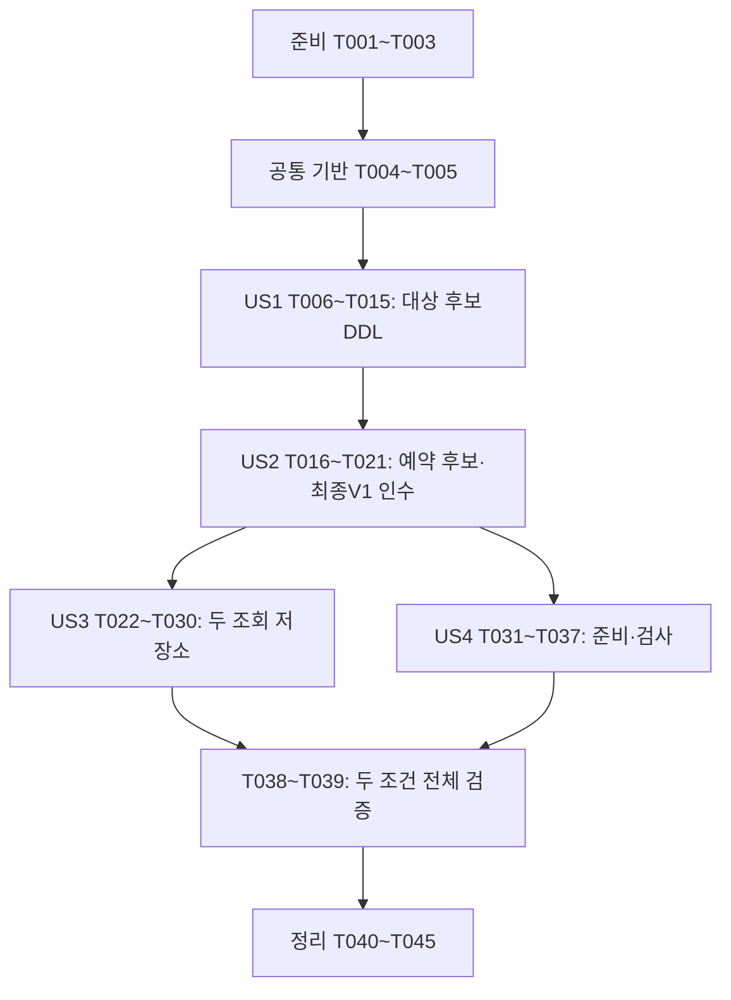

# 작업 목록: 예약 데이터 제약과 테스트 초기화

**입력**: [명세](spec.md), [계획](plan.md), [조사](research.md), [데이터 모델](data-model.md), [저장 계약](contracts/persistence-contract.md), [검증 안내](quickstart.md).
**작성일**: 2026-10-14
**상태**: 작업 목록 생성. 모든 작업은 미수행이며 업무 코드·SQL·테스트 실행 완료를 뜻하지 않는다.
**테스트**: 명세·계획서에서 직접 DB 제약 검증과 TDD를 요청했으므로 테스트 작업을 포함한다.
**구성**: 준비→공통 기반→US1(P1)→US2(P1)→US3(P2)→US4(P2)→공통 정리.

## 형식과 경로

`- [ ] T번호 [P 선택] [US번호 사용자 이야기 단계만] 구체 작업 및 파일 경로`를 사용한다. 모든 경로는 저장소 루트 기준이다. 명령은 별도 표시가 없으면 backend/에서 실행한다. [P]는 앞선 의존 작업 완료 후 서로 다른 파일에 한정한 병행 후보이며 자동 에이전트 실행 지시가 아니다.

작업 ID 순서는 권장 실행 순서다. 한 검증 대상의 테스트→의도한 실패→최소 구현→관련 검증을 끝낸 뒤 다음 대상으로 넘어간다. 컴파일·0매칭·테이블 부재·환경 오류를 기능 RED로 기록하지 않는다. 선택 명령의 --tests는 integrationTest에만 붙이고 Unit·실행 결과 게이트는 유지한다.

## Phase 1: 준비

**목표**: 기준 문서·검토 상태·로컬 작업 조건을 확인한다. 이 명령은 체크리스트 검토를 대신하지 않는다.

- [X] T001 specs/003-define-db-schema/checklists/database.md의 검토자 평가 상태와 specs/003-define-db-schema/checklists/requirements.md를 확인하고 docs/test-evidence.md에 구현 진입 가능 여부를 기록한다; 맞춤 목록은 사용자 요청에 따른 검토로CHK022 실패 처리 요구사항 보완·재평가로34개 충족 상태이며 구현자가 임의로 표시하지 않는다. 길이 보장 범위·새/재적용 범위·실패 복구에 미해결 계약이 있으면 해당 검토 근거를 받아 spec.md·plan.md를 동기화한 뒤 의존 작업을 진행한다.
- [X] T002 backend/gradlew로 --version, docker info를 실행하고 docs/versions.md·docs/test-evidence.md에 실제 환경과 종료 코드를 기록한다; Java25·Boot4.1.1·Gradle9.7.1·기존 이미지/BOM을 유지하고 개발 DB·local 프로필은 사용하지 않는다.
- [X] T003 knowledge/rules/commit.md·knowledge/rules/git-flow.md에 따라 저장소 최상위·HEAD·브랜치·미커밋 변경을 확인하고 docs/test-evidence.md에 실제 수행을 기록한다; 현재 문서 작업을 내용·링크·형식 검증 후 목적별 로컬 커밋으로 보존하고 develop 기반 feature/db-schema 작업 브랜치를 준비한다. 기존 문서 변경은 안전하게 통합·보존하며 reset/clean/stash로 없애거나 외부 push하지 않는다.

## Phase 2: 공통 기반

**목표**: 실제 격리 DB에 연결하는 지원 경로를 마련한다. 모든 이야기의 선행 조건이다.

- [X] T004 backend/src/test/java/com/limitedbooking/backend/support/ContainerTestSupport.java의 기존 무인자 생성자·public 필드·시작 실패 정리·종료 상한을 읽고 PostgreSQL-only 경로의 최소 접속/종료 기대를 backend/src/test/java/com/limitedbooking/backend/support/DatabaseSupportIT.java에 작성한다; 실행 소유 DB의 current_database()·동적 포트·미기동 Redis의 정리 제외를 확인할 사례를 둔다.
- [X] T005 backend/src/test/java/com/limitedbooking/backend/support/ContainerTestSupport.java에 PostgreSQL-only 경로를 추가하고 T004의 최소 실행과 기존 ToolchainSmokeIT·BackendApplicationIT을 선택 실행해 docs/test-evidence.md에 기록한다; 무인자 PostgreSQL+Redis 계약·고정 digest·120초 시작/컨테이너별10초 정리 상한을 유지한다. 환경 기반 추가이므로 최소 실행으로 검증하고 db/toolchain 위치·Gradle 게이트를 바꾸지 않는다.

**체크포인트**: 격리된 실제 PostgreSQL의 접속·종료를 확인했다. 업무 스키마는 아직 구현되지 않았다.

## Phase 3: US1 — 잘못된 수량 저장 차단 (P1, 최초 DDL MVP)

**목표**: 수량·대상 속성 제약을 한 검증 대상씩 테스트 우선으로 구현한다.
**독립 검증**: 실제 PostgreSQL의 후보 resources DDL에서 수량 10/-1·10/11·-1·1001 거부 및0/0·1000/1000·10/0·10/10 허용, 대상 필수 값·PK·저장 길이를 확인한다. 실제 업무 V1의 Flyway 적용 인수는 US2 완료 후이며 US1 MVP를 마이그레이션 완료로 표시하지 않는다.

- [X] T006 [US1] backend/src/test/java/com/limitedbooking/backend/common/SchemaIT.java에 rejectsInvalidAvailability와 acceptsAvailabilityBoundaries를 작성한다; 10/-1·10/11·-1·1001은23514·실패 행 없음, 0/0·1000/1000·10/0·10/10은 저장 값 일치를 기대한다. 실패 SQL 이후는 autocommit의 새 조회 또는 롤백 후 조회다.
- [X] T007 [US1] backend/src/test/resources/db/schema-candidate/schema.sql에 현재 수량 CHECK가 없는 resources 컬럼 구조만 마련하고 backend/src/test/java/com/limitedbooking/backend/common/SchemaIT.java에서 이번 실행 소유 DB에 JDBC로 직접 준비한다; id UUID·capacity/available integer·created_at timestamptz의 컬럼 형태는 갖추되 나중에 검증할 NOT NULL·PK는 아직 없고 name은 text로 둔다. 이 파일은 임시 후보이며 Flyway migration이 아니다.
- [ ] T008 [US1] ./gradlew test integrationTest --tests '*SchemaIT.rejectsInvalidAvailability'를 실행하고 docs/test-evidence.md에 실제 비정상 수량 INSERT가 허용돼 기대 거부 assertion이 실패한 RED를 기록한다; 컴파일·42P01·컨테이너·0건 오류는 제약 RED로 사용하지 않는다.
- [ ] T009 [US1] RED 이후 backend/src/test/resources/db/schema-candidate/schema.sql의 resources CREATE 정의에 `capacity BETWEEN 0 AND 1000`·`available BETWEEN 0 AND capacity` CHECK만 최소 추가한다; Model의 capacity `0~1000, 최초 수량 불변`·available `0~capacity`를 유지한다. 아직 검증하지 않은 예약·필수 값·PK·길이 제약이나 업무 V1은 작성하지 않는다.
- [ ] T010 [US1] 새 소유 DB에 T009 후보를 직접 적용하고 T006의 동일 테스트·정상 경계를 실행해 docs/test-evidence.md에 후보 DDL GREEN을 기록한다; Flyway 업무 V1 GREEN으로 보고하지 않는다.
- [ ] T011 [US1] backend/src/test/java/com/limitedbooking/backend/common/SchemaIT.java에 resources id·name·capacity·available·created_at 각각의 null23502·실패 행 없음 및 정상 저장 사례를 작성한다; T007 후보의 nullable 상태에서 검증할 다음 한 속성만 선택해 RED를 확인한다.
- [ ] T012 [US1] backend/src/test/resources/db/schema-candidate/schema.sql의 현재 검증 속성에만 NOT NULL을 추가하고 새 DB의 같은 테스트 GREEN을 확인한 뒤 T011~T012를 다음 속성에 반복한다; Model의 모든 대상 속성 null `불가`, id `uuid`·name 최종 `varchar(100)`·capacity/available `integer`·created_at `timestamptz`와 `생성 시각, UTC·마이크로초`를 보존한다. name의 길이 제한은 T013의 RED 이후에만 추가한다. 속성별 RED/GREEN을 docs/test-evidence.md에 기록한다.
- [ ] T013 [US1] backend/src/test/java/com/limitedbooking/backend/common/SchemaIT.java와 backend/src/test/resources/db/schema-candidate/schema.sql에서 대상 PK 및 이름 길이를 각각 테스트→RED→현재 CREATE 정의 최소 수정→새 DB GREEN 순서로 인수한다; PK중복23505·기존 행 보존, 비공백ASCII/😀100자 허용·101자22001 거부, 최종 name `varchar(100) NOT NULL`·id PK를 요구한다. 길이는 문자 수이며 비공백100자+일반공백1자는100자로 절단 저장되는 별도 정상 사례다. 거부 시험에 명시적 varchar cast를 쓰지 않는다.
- [ ] T014 [US1] ./gradlew test integrationTest --tests '*SchemaIT'로 현재 resources 후보 전체 사례의 실행수>0·실패0·skip0·listener/XML 일치를 확인하고 docs/test-evidence.md에 기록한다; 아직 업무 V1은 생성/적용하지 않았으며 두 준비 조건의 최종 검증은 T038에 남긴다.
- [ ] T015 [US1] knowledge/domain/resource.md·docs/test-evidence.md에 후보 DDL 인수·속성별 RED/GREEN·업무 V1 미적용 상태를 기록하고 검증한 수량/대상 기반의 로컬 커밋을 작성한다; 임시 후보는 이후 US2에서 완성·이동·제거할 예정이며 최종 생산 파일로 링크하지 않는다.

**체크포인트**: 실제 DB에서 대상 제약을 인수했다. US1은 후보 DDL MVP이며 Flyway 업무 스키마 인수는 아직 미완료다.

## Phase 4: US2 — 예약 식별·참조·상태 일관성 (P1)

**목표**: 예약 제약을 테스트 우선으로 인수한 뒤 검증된 두 테이블을 하나의 업무 V1로 옮긴다.
**독립 검증**: Service·HTTP·US3 없이 직접 SQL로 사용자/키·참조·상태·속성 제약을 검사한다. 후보 인수 후 실제 V1에서 전체 동일 사례가 통과해야 한다.

- [ ] T016 [US2] backend/src/test/java/com/limitedbooking/backend/common/SchemaIT.java에 enforcesUserKeyUniqueness를 먼저 작성하고 backend/src/test/resources/db/schema-candidate/schema.sql에 예약 컬럼 형태만 추가해 UNIQUE 없는 RED를 확인한 뒤 `uq_reservations_user_key(user_id,idempotency_key)`를 최소 추가하고 새 DB GREEN을 확인한다; A/key1 동일·다른 대상·CANCELLED 기존 행 중복23505+제약이름·기존 행 보존, B/key1·A/key2 허용을 기대한다. 초기 예약 id/resource_id/user_id는uuid, created_at/cancelled_at은timestamptz, key/status는text이고 아직 검증하지 않은 FK·CHECK·NOT NULL·PK·길이·인덱스는 추가하지 않는다. 각 결과는 docs/test-evidence.md에 기록한다.
- [ ] T017 [US2] backend/src/test/java/com/limitedbooking/backend/common/SchemaIT.java와 backend/src/test/resources/db/schema-candidate/schema.sql에서 FK와 상태를 각각 테스트→RED→현재 CREATE 정의에 제약 최소 추가→새 DB GREEN으로 인수한다; 존재하지 않는대상23503, 두 정상 상태/취소시각 조합 허용, CONFIRMED/시각있음·CANCELLED/시각없음·알 수 없는상태23514를 기대한다. CHECK는 `(status = 'CONFIRMED' AND cancelled_at IS NULL) OR (status = 'CANCELLED' AND cancelled_at IS NOT NULL)`이며 실패 행 없음/기존 행 보존을 docs/test-evidence.md에 기록한다.
- [ ] T018 [US2] backend/src/test/java/com/limitedbooking/backend/common/SchemaIT.java와 backend/src/test/resources/db/schema-candidate/schema.sql에서 예약 필수 속성 각각→예약PK→키/상태 저장타입→대상인덱스를 한 검증 대상씩 테스트→RED→최소 DDL→새 DB GREEN으로 인수한다; id `uuid`·null `불가`·`PK`, resource_id `uuid`·null `불가`·`resources.id 참조, 생성 후 불변`, user_id `uuid`·null `불가`·`인증 사용자 UUID, 생성 후 불변`, key `varchar(64)`·null `불가`·`성공 생성 키, 변환 없이 저장, 생성 후 불변`, status `varchar(16)`·null `불가`·`CONFIRMED 또는 CANCELLED`, created_at `timestamptz`·null `불가`·`생성 후 불변, UTC·마이크로초`, cancelled_at `timestamptz`·null `가능`·`상태 조합에 따라 필수 여부 결정`을 유지한다. 필수값23502·PK중복23505·비공백키64/65 허용/22001·비공백64자+일반공백1자의64자 절단 저장·`idx_reservations_resource_id(resource_id)`의 존재/유효/비부분을 확인하고 docs/test-evidence.md에 기록한다. status 폭은 현재 CHECK와 함께 저장 메타데이터로 인수한다.
- [ ] T019 [US2] T016~T018의 제약별 GREEN 이후 backend/src/test/resources/db/schema-candidate/schema.sql의 최종 CREATE DDL을 수정 없이 backend/src/main/resources/db/migration/V1__create_reservation_schema.sql에 복사한다; 모든 컬럼·PK·NOT NULL·CHECK·FK·UNIQUE·인덱스가 같은 내용인지 비교해 docs/test-evidence.md에 기록한다. 새 users FK·CASCADE·TTL·트리거·자동 UUID/시각 기본값은 추가하지 않는다. 후보 최종 내용에는 ALTER 변경 이력이 없으며 아직 Flyway로 적용하지 않는다.
- [ ] T020 [US2] backend/src/test/java/com/limitedbooking/backend/common/SchemaIT.java를 classpath:db/migration 사용으로 바꾸고 backend/src/test/resources/db/schema-candidate/schema.sql과 후보 선택 분기를 제거한다; 새 격리 DB에서 실제 V1 migrate1건·./gradlew test integrationTest --tests '*SchemaIT' 전체 GREEN을 docs/test-evidence.md에 기록한다. 후보 RED/GREEN과 이 Flyway 적용 증거를 구분하고 최초 적용 뒤 V1을 편집하지 않는다. 실제 성공 적용 전에 SchemaIT.rollsBackFailedMigrationAndRecoversInNewDatabase를 작성하고 원본 V1의 테스트 전용 사본 마지막에22012 오류를 붙여 Flyway 트랜잭션 적용 실패·두 업무 테이블/인덱스 부재·V1 성공 이력0건을 확인한다. 이력 테이블의 존재는 별도로 판정하고 실패 DB 증거/종료 뒤 다른 실행소유 DB에 원본 V1을1건 적용해 제약을 검사한다. clean/repair·자동 재시도·생산 V1 변경은 하지 않는다. 고의 실패 사본의 내용/경로와 정상 원본의 체크섬을 docs/test-evidence.md에 구분해 기록한다.
- [ ] T021 [US2] knowledge/domain/resource.md·knowledge/domain/reservation.md·docs/test-evidence.md에 실제 V1·대상/예약 제약 인수와 임시경로제거를 연결하고 검증한 업무 스키마 로컬 커밋을 작성한다; API·멱등응답·경쟁·상태전이 보장은 미검증으로 유지한다.

**체크포인트**: 두 테이블과 각 제약을 테스트 우선으로 인수하고 실제 Flyway V1 적용을 확인했다. 생성·취소 API는 미구현이다.

## Phase 5: US3 — 저장된 대상·성공 예약 조회 (P2)

**목표**: 두 읽기 인터페이스와 저장 값 매핑을 제공한다.
**독립 검증**: 실제 V1과 직접 커밋한 데이터만으로 대상4필드·예약7필드, 행 없음, 사용자/키 분리, 취소 상태, 저장 시각 일치를 확인한다. TestData 완성이나 Writer는 필요하지 않다.

- [ ] T022 [P] [US3] backend/src/test/java/com/limitedbooking/backend/resource/ResourceRepositoryIT.java에 대상4필드 저장 값 일치·없는UUID empty를 기대하는 테스트를 작성한다; 직접 SQL로 준비하고 아직 없는 조회 모델/시그니처는 T024~T026에서 보완한다.
- [ ] T023 [P] [US3] backend/src/test/java/com/limitedbooking/backend/reservation/ReservationRepositoryIT.java에 사용자/키 정확일치·다른 사용자·다른 키·대소문자 다른 키·취소 예약·전체7컬럼·UTC마이크로초 시각·null 취소 시각을 검증하는 테스트를 작성한다; 실제 저장 값을 기대하고 입력은 고정 Instant를 마이크로초로 맞춘 UTC 값으로 준비한다.
- [ ] T024 [P] [US3] backend/src/main/java/com/limitedbooking/backend/resource/ResourceView.java에 `resource.ResourceView(UUID id, String name, int capacity, int available)` record를 작성한다; Model의 `조회의 4개 컬럼. created_at은 저장되지만 이 모델에 포함하지 않는다`를 그대로 따른다.
- [ ] T025 [P] [US3] backend/src/main/java/com/limitedbooking/backend/reservation/ReservationStatus.java와 backend/src/main/java/com/limitedbooking/backend/reservation/StoredReservation.java를 작성한다; `ReservationStatus는 CONFIRMED/CANCELLED 두 값만 갖는다`, `reservation.StoredReservation(UUID id, UUID resourceId, UUID userId, String idempotencyKey, ReservationStatus status, Instant createdAt, Instant cancelledAt)` 및 `cancelledAt은 null 허용이다`를 보존한다. 취소 예약을 CONFIRMED로 바꾸지 않는다.
- [ ] T026 [US3] backend/src/main/java/com/limitedbooking/backend/resource/ResourceRepository.java와 backend/src/main/java/com/limitedbooking/backend/reservation/ReservationRepository.java에 컴파일 가능한 최소 생성자·find(UUID id): Optional<ResourceView>·findByUserAndKey(UUID userId,String key): Optional<StoredReservation> 시그니처를 준비한 뒤 두 RepositoryIT를 실행한다; 실제 존재 행이 empty 등 잘못된 값으로 반환되는 assertion RED를 docs/test-evidence.md에 기록하고 컴파일 실패와 구별한다.
- [ ] T027 [P] [US3] backend/src/main/java/com/limitedbooking/backend/resource/ResourceRepository.java에 생성자 주입 NamedParameterJdbcTemplate·명시적4컬럼·id 바인딩 조회를 구현한다; 0행만 Optional.empty로 반환하고 SQL/연결 오류는 전달한다. T026 이후 T028과 파일을 분리한다.
- [ ] T028 [P] [US3] backend/src/main/java/com/limitedbooking/backend/reservation/ReservationRepository.java에 사용자UUID/원문키 바인딩·명시적7컬럼·UUID/상태/OffsetDateTime→Instant 매핑을 구현한다; null 취소 시각·CANCELLED를 보존하고 SQL/매핑/연결 오류 및 비정상 복수행을 empty나 첫 행으로 숨기지 않는다.
- [ ] T029 [US3] ./gradlew test integrationTest --tests '*ResourceRepositoryIT' --tests '*ReservationRepositoryIT'를 실행하고 docs/test-evidence.md에 RED→GREEN·속성별 비교·조회 전후 데이터 불변·실행수/실패/skip을 기록한다; Repository는 권한·HTTP·Writer 책임을 추가하지 않는다.
- [ ] T030 [US3] knowledge/domain/resource.md·knowledge/domain/reservation.md·docs/test-evidence.md의 실제 조회 코드/테스트 링크를 갱신하고 읽기 저장소 검증 커밋을 작성한다.

**체크포인트**: 저장 조회 계약을 인수했다. HTTP 응답·인증·멱등 재현의 검증으로 보고하지 않는다.

## Phase 6: US4 — 격리된 초기화·수량 보존 검사 (P2)

**목표**: 커밋된 준비 데이터·반복 초기화·한 관측 시점의 검사를 제공하고 두 준비 조건을 완성한다.
**독립 검증**: 실제 V1과 명시 DataSource로만 데이터 준비/초기화·이력 보존·정상/불일치/대상 부재 판정을 검증한다. 애플리케이션 Service·HTTP·Redis는 필요하지 않다.

- [ ] T031 [US4] backend/src/test/java/com/limitedbooking/backend/support/DatabaseSupportIT.java에 정상 대상·두 예약 상태 준비, 별도 연결의 조회, 두 번 초기화 후 reservations/resources 각각0행, 저장 구조·Flyway 이력 보존 사례를 작성한다; DataSource는 컨테이너 소유 값만 전달하고 개발 DB 접속으로 격리를 확인하지 않는다. rollsBackFailedResetAndRetriesAfterFaultRemoval도 먼저 작성한다; 커밋된 양쪽 행/값·Flyway 이력 스냅샷, 예약 삭제 후 대상 DELETE에서22012를 내는 테스트 전용 트리거, 예외 뒤 별도 연결의 스냅샷 불변, 장애 제거 후 같은 DB의 명시적 초기화 재요청을 기대한다. 트리거는 테스트가 소유한 DB에만 설치하고 TestData 공개 장애 인자를 추가하지 않는다.
- [ ] T032 [US4] backend/src/test/java/com/limitedbooking/backend/support/TestData.java에 컴파일 가능한 최소 인터페이스를 준비하고 T031의 실제 준비/초기화 assertion RED를 docs/test-evidence.md에 기록한다; 실패한 트랜잭션을 계속 조회하지 않으며 준비 실패와 assertion 실패를 구분한다.
- [ ] T033 [US4] backend/src/test/java/com/limitedbooking/backend/support/TestData.java에 명시 DataSource·UUID/수량/상태/고정시각 준비·커밋 후 반환 및 reservations→resources DELETE 한 트랜잭션 초기화를 구현한다; 정상 데이터 보존식은 호출 측이 명시 구성하고 의도적 불일치를 자동 보정하지 않는다. 중간 SQL 실패는 예외를 전달하고 두 DELETE 전체를 롤백하며 자동 재시도하지 않는다. Flyway clean·이력 삭제·local 환경fallback·앱 Bean 등록은 추가하지 않는다.
- [ ] T034 [US4] T031의 준비/초기화 테스트를 ./gradlew test integrationTest --tests '*DatabaseSupportIT'로 실행해 docs/test-evidence.md에 GREEN·반복2회·별도 연결 가시성·이력/구조 유지와 중간 실패의 전체 롤백·장애 제거 후 같은 DB 재요청·장애 트리거 정리 결과를 기록한다. 상태 조회가 불가능하면 불명/실패로 기록하고 해당 환경의 후속 사례를 중단한다.
- [ ] T035 [US4] backend/src/test/java/com/limitedbooking/backend/support/DatabaseSupportIT.java에 수량 검사 사례를 작성한다; 10/8/CONFIRMED2/CANCELLED1·0/0/예약0·전부취소·다른대상예약 제외는 정상, 10/9/CONFIRMED2 및 없는대상은 AssertionError를 기대한다. 기존 제약이 거부하는 데이터와 개별 제약을 만족하는 불일치를 구분한다.
- [ ] T036 [US4] backend/src/test/java/com/limitedbooking/backend/support/DatabaseAssertions.java에 최소 assertInventoryConserved(UUID resourceId) 시그니처를 준비하고 T035의 불일치/대상부재 탐지가 빠져 assertion이 실패하는 RED를 docs/test-evidence.md에 기록한다; 정상 검사만으로 탐지력을 완료 처리하지 않는다.
- [ ] T037 [US4] backend/src/test/java/com/limitedbooking/backend/support/DatabaseAssertions.java에 SELECT1회로 대상 capacity·available·CONFIRMED 수를 관측하는 검사를 구현한다; Model의 `0≤available≤capacity`·`available+confirmedCount=capacity`를 모두 검사하고 취소/타대상예약 제외·예약없는대상0·대상없음실패를 보존한다. 진단은 대상UUID/관측수량만 포함하고 연결 오류를 통과로 바꾸지 않는다.
- [ ] T038 [US4] backend/src/test/java/com/limitedbooking/backend/common/SchemaIT.java·backend/src/test/java/com/limitedbooking/backend/resource/ResourceRepositoryIT.java·backend/src/test/java/com/limitedbooking/backend/reservation/ReservationRepositoryIT.java·backend/src/test/java/com/limitedbooking/backend/support/DatabaseSupportIT.java에 fresh/reapplied 조건을 연결한다; 소유하는 독립DB를 순차 준비해 최초migrate1건, 재적용validate성공/migrate0건·표식/이력 보존 후 같은 제약·조회·초기화 인수 사례를 두 조건에 실행한다. 같은 준비 구조는 테스트 지원 패키지에서 최소 공유하고, 필요한 경우 정확한 지원 파일 경로를 specs/003-define-db-schema/plan.md에 등록한다. 테스트 전체 @Transactional·클래스 병렬·재적용전clean은 금지한다.
- [ ] T039 [US4] ./gradlew test integrationTest --tests '*SchemaIT' --tests '*ResourceRepositoryIT' --tests '*ReservationRepositoryIT' --tests '*DatabaseSupportIT'를 실행해 두 모드 및 준비/검사의 GREEN을 docs/test-evidence.md에 기록하고 검증한 테스트 지원 커밋을 작성한다; 후보 SQL/분기 잔존0·실행소유DB·모드별실행수·정리종료를 포함한다.

**체크포인트**: 네 이야기의 인수 사례와 테스트 도구의 탐지력을 확인했다. 전체 수량 정합성의 경쟁 보장은 후속이다.

## Phase 7: 공통 정리·완료 기록

- [ ] T040 backend/build.gradle의 기존 verify를 ./gradlew verify로 실행해 변경된 ContainerTestSupport·업무V1·읽기코드가 기존 Unit/일반IT를 깨지 않음을 확인하고 docs/test-evidence.md에 실제 수·실패0·skip0·현재listener/XML 일치를 기록한다; 새 실패/수정이 없으면 Property/PIT/부하까지 확장 반복하지 않는다.
- [ ] T041 [P] knowledge/domain/resource.md에 실제 책임·migration·조회·테스트·불변식검사의 연결과 후속 입력/HTTP 미검증을 갱신한다; T040 이후 T042와 서로 다른 문서를 담당한다.
- [ ] T042 [P] knowledge/domain/reservation.md에 실제 전체 저장속성·키제약·현재상태조회·수량검사 연결을 갱신하고 원자성/권한/경쟁/응답재현 미검증을 유지한다; T040 이후 T041과 파일을 분리한다.
- [ ] T043 README.md·knowledge/README.md·docs/versions.md·docs/decisions.md·docs/test-evidence.md·specs/003-define-db-schema/quickstart.md를 실제 파일·명령·버전·검증 결과에 맞춰 갱신한다; docs/openapi.yaml의 변경 없음과 실행 증거를 대조하고 아직 없는 후속 API·CI·부하를 완료로 기록하지 않는다.
- [ ] T044 specs/003-define-db-schema/spec.md의 FR-001~011·SC-001~005를 실제 테스트/명령/증거와 연결해 docs/test-evidence.md에 누락·미검증을 기록한다; '한정 수량 예약 백엔드 로컬 개발 계획.md' 2단계 체크박스는 해당 실제 수행·검증 후에만 표시하고 맞춤 database.md 검토 표시는 대신 변경하지 않는다.
- [ ] T045 knowledge/rules/commit.md·knowledge/rules/git-flow.md에 따라 변경 파일·diff·공백·임시경로제거·보고서를 검토한 뒤 docs/test-evidence.md에 최종코드·SQL·테스트·미검증·다음작업을 연결하고 남은 목적별 로컬 커밋을 작성한다; PR/push/병합/태그/외부CI는 이번 구현 완료에 포함하지 않는다.

## 의존성과 실행 순서

US1은 후보 resources DDL의 제약별 인수까지 진행하고 US2에서 reservations를 같은 순서로 완성한다. 해당 제약 테스트와 RED를 확인한 뒤에만 후보에 제약을 추가한다. 각 변경은 새 소유 DB의 같은 테스트 GREEN으로 마무리한 뒤 다음 제약으로 이동한다. 최초 업무 V1 작성·적용은 모든 대상/예약 제약 인수 후 T019~T020이다. 후보 파일은 임시 개발용이며 최종 후보 내용과 V1 복사의 동일성 및 제거를 검사한다. Flyway로 적용된 V1을 편집하는 경로는 없다.

US3·US4는 US2 이후 각자의 직접 SQL 인수로 개발 가능하다. 다만 T038은 US3의 두 RepositoryIT와 US4의 지원코드가 모두 준비돼야 시작한다. T031~T037을 US3와 병행하더라도 T038~T039는 순차 통합한다. 기본 실행은 ID 순서이며 공유 SchemaIT·V1·증거 파일을 여러 작업자가 동시에 편집하지 않는다.

### 세부 병행 후보와 이야기별 예시

| 이야기 | 선행 조건 | 병행 또는 순차 예시 |
| --- | --- | --- |
| US1 | T005 완료 | SchemaIT·후보 SQL을 공유하므로 T006→T008→T009→T010, 이후 T011~T013의 대상별 순환을 순차 수행. 같은 파일의 병행 후보 없음 |
| US2 | T015 완료 | SchemaIT와 후보 SQL을 공유하므로 T016~T018을 제약별 순차 수행한 뒤 T019~T020에서 V1 복사·적용. 병행 후보 없음 |
| US3 | T021 완료 | T022↔T023 테스트 파일 작성, T024↔T025 읽기 모델 작성; 둘 다 준비된 T026의 RED 이후 T027↔T028 저장소 구현. 공동 Gradle 실행·증거 갱신은 T029에서 순차 |
| US4 | T021 완료 | T031~T037은 같은 지원코드/IT의 TDD 순서 유지. US3와 별도 파일의 준비·검사는 가능하지만 공통 모드 적용 T038과 증거 작성은 순차 |

정리 단계에서는 T040 완료 후 T041↔T042 문서 갱신만 병행 가능하다. [P] 작업의 선행 검증이 실패했거나 필요한 계약이 미확정이면 해당 후보도 시작하지 않는다.

## 요구사항·인수 기준 추적

| 요구사항 | 작업 | 독립 판정 |
| --- | --- | --- |
| FR-001 | T006~T014 | 잘못된 수량 거부·경계 허용 |
| FR-002 | T011~T013·T018~T020 | 필수값·PK·저장길이·컬럼 계약 |
| FR-003~004 | T016~T020 | 키·참조·상태 조합 거부/허용 |
| FR-005~006 | T022~T029 | 전체 조회값·empty·사용자/키·현재 상태·시각 |
| FR-007 | T020·T038~T039 | 최초/재적용·실패롤백·새DB복구·이력 |
| FR-008~009 | T004~T005·T031~T034·T038 | 소유DB·가시성·초기화실패롤백/재요청·이력 |
| FR-010 | T035~T039 | 정상 통과·불일치/대상부재 탐지 |
| FR-011 | T008·T011·T014~T015·T019~T021·T026·T029~T030·T032~T045 | 실제 종료코드·수·실패/skip·미실행 구분 |

SC-001의 명시된 제약 위반 거부와 공백 초과분 절단 저장은 US1·US2, SC-002는 US3, SC-003은 T020의 마이그레이션 실패/새DB복구와 US4의 두 조건·초기화 실패/명시적 재요청, SC-004는 US4의 검사 탐지력, SC-005는 각 단계 실행 기록 및 T044에 대응한다.

## 구현 전략과 메모

최초 MVP는 준비·공통 기반·US1까지다. 수량0 포함 경계와 거부 결과를 직접 SQL로 설명할 수 있어야 하며 예약 생성 기능 완료를 뜻하지 않는다. 이어서 US2의 예약 제약 인수→US3의 조회→US4의 재현 기반→영향 검증 순서로 진행한다. 후보 DDL은 검증 대상 하나씩 최소 추가하고, 두 테이블이 완성된 뒤 실제 V1로 옮긴다. US1의 후보 DDL 인수와 US2 이후의 Flyway 인수를 구분한다.

맞춤 체크리스트의 생성·작업 목록 작성은 검토자 평가가 아니다. 해당 상태를 구현 절차의 게이트에서 확인한다. 문서에 실제 계약 차이가 있으면 기준을 확인·동기화하고, 테스트 통과를 위해 기대값을 임의로 낮추지 않는다. 구현에는 계획서의 superpowers:executing-plans 절차를 적용하고, 독립 작업의 병행이 명시적으로 선택된 경우에만 대응 절차를 사용한다.

각 검증 단위 통과 후 작은 커밋을 남긴다. 적용된 migration 수정, 실패 무시·skip·mock 대체, 개발DB 초기화, 외부 push/공개는 하지 않는다. 현재 이 목록의 모든 체크박스는 미수행이다.
