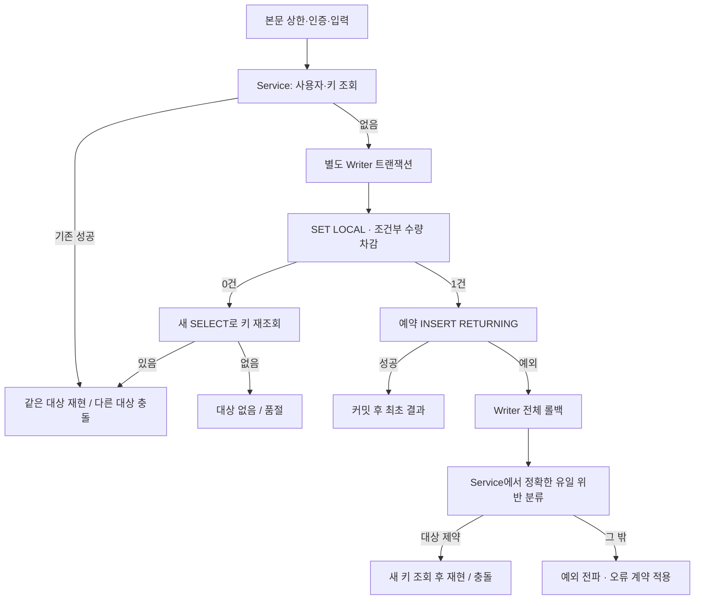

# 구현 계획: 예약 생성·성공한 키·롤백

**실제 구현 Git 브랜치**: `feature/reservation-create` (설계 당시 `docs/reservation-create-spec`) | **작성일**: 2026-10-19 | **명세**: [spec.md](spec.md)

**입력**: `specs/006-reservation-create/spec.md`, 로컬 개발 계획 2~5절·7절 5단계.

**상태**: Phase 0 조사·Phase 1 설계와5단계 코드·테스트 구현 및 지정 실행 인수를 완료했다. 최종 결과는 docs/test-evidence.md를 따른다. 아래 예정 표현은 구현 전 설계이며 실제 상태는 이 절과 실행 기록이 우선한다. setup-plan의 `BRANCH=006-reservation-create`는 활성 기능에서 도출한 값이며 실제 Git 브랜치를 생성하거나 전환한 결과가 아니다.

## 요약

인증 사용자가 수량 한 개를 예약하고 같은 성공 키로 최초 생성 결과를 재현한다. Service는 트랜잭션 밖에서 키를 확인·조정하며 별도 Writer Bean이 READ COMMITTED에서 조건부 수량 차감과 예약 저장을 함께 커밋한다. 사용자·키 유일 위반만 전체 롤백 후 새 조회로 재현/충돌을 판별한다. 저장 시각을 마이크로초로 정규화하고 저장 후 반환값을 최초 응답에도 사용한다.

이번 단계는 생성·성공 키·저장 실패의 원자성을 구현한다. 취소는 준비된 CANCELLED 행의 생성 재현만 다루고, 실제 조회·취소·경쟁 반복·Redis 제한은 6~8단계다. [조사](research.md), [데이터 모델](data-model.md), [계약](contracts/reservation-create-contract.md), [검증 안내](quickstart.md)를 함께 사용한다.

## 기술 맥락

- **언어/빌드**: Java 25, preview 제외, 기존 Gradle Wrapper 9.7.1 유지.
- **주요 의존성**: Boot 4.1.1, MVC/Security/JDBC/Validation/Flyway 및 Boot BOM 관리 PostgreSQL 드라이버. 현재 `runtimeOnly` 드라이버를 `implementation`으로 옮겨 서버 오류 메타데이터를 타입으로 읽는다. 버전 신규 지정·하향 없음.
- **저장소**: 기존 PostgreSQL 18.6 고정 이미지/digest·V1 스키마·NamedParameterJdbcTemplate. 별도 키 테이블·마이그레이션·ORM·H2 없음. Redis는 이번 생성 처리의 저장·락에 사용하지 않는다.
- **검증**: 기존 Jupiter 6.0.3/AssertJ/Testcontainers 2.0.5 기반. 실제 Authorization과 RANDOM_PORT HTTP 및 격리된 실제 PostgreSQL을 사용한다. Unit은 `*Test`, 통합은 `*IT`, JUnit 클래스 병렬 실행은 끈다.
- **플랫폼/유형**: localhost CLI/API 클라이언트용 단일 백엔드. 기존 `backend/`, `com.limitedbooking.backend` 유지.
- **성능 목표**: 이번 단계에 새 처리량·지연 SLO를 만들지 않는다. 수량·예약·키 정합성이 인수 기준이며 부하 측정은 11단계다.
- **제약**: lock_timeout 2초·statement_timeout 5초를 Writer 시작 시 SET LOCAL, 풀 최대 10·획득 대기 3초. 요청 본문 8192바이트·엄격 JSON·인증을 기존 경계에서 적용한다. 실패/timeout은 부분 반영 금지. 신규 ReservationCreateIT·IdempotencyIT·ReservationRollbackIT에도 동적 접속 정보와 함께 spring.datasource.hikari.maximum-pool-size=10·spring.datasource.hikari.connection-timeout=3000을 명시한다. local 프로필로 개발 DB 설정을 가져오지 않고 실제 DataSource 적용값을 확인한다. 정확히3초의 응답 시간이 아니라 설정값·유한 종료·오류/롤백 결과를 판정한다.
- **규모/범위**: 대상별 capacity 0~1000, 요청당 한 개, 사용자·키당 예약 최대 하나. 고정 ADMIN/USER_A/USER_B 모두 인증 사용자로 생성 가능. 외부 공개·수량 변경·목록·취소 구현 제외.
- **실제 상태**: V1·읽기 Repository·IdempotencyKey·인증·UTC Clock·공통 오류·테스트 지원은 존재한다. 생성 Controller/Service/Writer/결과 DTO/분류기 및 지정 세 IT를 구현했다. 버전과 기존 실행 근거는 [versions](../../docs/versions.md)·[증거](../../docs/test-evidence.md)를 따른다. 구현 후 실제 새 Unit/IT와 기존 회귀를 실행했다.

## 헌법 점검

| 관문 | 조사 전 | 설계 후 근거 |
| --- | --- | --- |
| I. 서비스 경계·계약 보존 | 충족 | Controller→Service→별도 Writer→Repository, 기존 201/Location/Replay 및 오류 계약 유지 |
| II. 문서·코드 대조 | 충족 | knowledge 규칙·관련 도메인·계획서·V1·실제 Java/Gradle/IT 지원을 대조 |
| III. 검증·증거 | 충족 | 첫 HTTP 실패→최소 구현→관련 검증, 실패 주입은 테스트에만 존재, 0건·skip 금지 |
| IV. 문서 동기화 | 충족 | 새 설계를 지식 목록·예약 도메인·결정/검토 기록에 연결; 기존 정책 변경 없음 |
| V. 미확정 정책 | 충족 | clarify 질문 0개, 새로운 업무 정책 없음; 런타임 검증은 미실행으로 구분 |

Phase 0/Phase 1 관문 모두 설계 기준으로 충족한다. 2026-10-19 분석 후 사용자 승인으로 작업 순서를 T019 테스트·RED→T020 구현·GREEN으로 보완했고, 테스트 풀 설정과 입력/품절 후 같은 키 재시도 기준을 관련 문서에 맞췄다. 이는 문서 재검토 결과이며 기능 실행 통과가 아니다. 헌법의 과거 골격·CI/채택일 TODO는 이번 기능의 새 미확정 정책으로 간주하지 않는다. 외부 CI·헌법 채택 여부를 이번 계획으로 완료 처리하지 않는다.

## 프로젝트 구조

### 기능 문서

```text
specs/006-reservation-create/
  spec.md
  plan.md
  research.md
  data-model.md
  quickstart.md
  contracts/reservation-create-contract.md
  checklists/requirements.md
  checklists/reservation-create.md
  tasks.md
```

`tasks.md`는 후속 `$speckit-tasks`에서 생성했다. 작업 생성·체크리스트 품질과 기능 구현·실행 검증은 별개이며 실제 수행 상태는 tasks.md를 따른다.

### 소스 구조와 변경 책임 (예정)

| 위치 (`backend/` 기준) | 책임·변경 |
| --- | --- |
| `src/main/java/com/limitedbooking/backend/reservation/ReservationController.java` | 신규 생성 경로·인증 UUID·요청/응답 변환 |
| 동일 패키지 `CreateReservationRequest.java`, `CreatedReservationView.java`, `CreateReservationResult.java` | resourceId 입력, 고정 생성 결과와 replayed record |
| 동일 패키지 `ReservationService.java` | 키 선조회·Writer 호출·롤백 뒤 유일 위반 복구, 활성 상위 트랜잭션 거부 |
| 동일 패키지 `ReservationWriter.java` | 별도 Bean의 READ_COMMITTED 트랜잭션·SET LOCAL·차감·INSERT |
| 동일 패키지 `ReservationRepository.java` | 기존 키 조회 유지·INSERT RETURNING 추가 |
| `src/main/java/com/limitedbooking/backend/resource/ResourceRepository.java` | available>0 조건 UPDATE 추가, 기존 find로 대상 존재 확인 |
| `src/main/java/com/limitedbooking/backend/common/UniqueViolationClassifier.java` | 원인 체인에서 SQLSTATE와 제약명 일치 판별 |
| `src/main/java/com/limitedbooking/backend/common/ApiExceptionHandler.java` | 생성의 SOLD_OUT·IDEMPOTENCY_CONFLICT 409 연결 |
| `build.gradle` | PostgreSQL 드라이버 컴파일 범위 조정; 기존 태스크/게이트 유지 |
| `src/test/java/com/limitedbooking/backend/reservation/ReservationCreateIT.java` | 최초 성공·대상 없음·품절·잘못된 입력·인증·불변식 |
| 동일 테스트 패키지 `IdempotencyIT.java` | 재현·충돌·사용자/키 격리·정밀도·취소된 준비 데이터 재현 |
| 동일 테스트 패키지 `ReservationRollbackIT.java` | 실제 UPDATE 후 저장 실패·복구·동일 키 재시도 |
| `src/test/java/com/limitedbooking/backend/common/UniqueViolationClassifierTest.java` | 대상 제약 true, 다른 PK/FK/연결/메타데이터 누락 false |
| reservation의 순수 `ReservationServiceTest.java` | 조정 분기·중복 예외 이후 새 조회·기존 성공 누락 내부 오류 |

거대한 공통 서비스·범용 Repository는 추가하지 않는다. 기존 TestData/DatabaseAssertions/HTTP 지원을 재사용하고 필요한 실패 제어 래퍼는 테스트 파일 안에 한정한다.

## Phase 0: 조사 결과

[research.md](research.md)에 선택·이유·대안과 공식 근거를 기록했다. 트랜잭션은 별도 프록시 Bean, 유일 위반은 구조화된 PostgreSQL 메타데이터, 최초 응답은 저장된 시각, 장애는 실제 쓰기 SQL을 유지한 테스트 래퍼를 선택했다. 새로운 업무 정책 질문은 없다.

## Phase 1: 생성 흐름과 검증 설계



UPDATE 0 뒤 SELECT는 오류가 발생하지 않은 Writer 트랜잭션의 새로운 문장이다. INSERT 유일 위반 뒤 SELECT는 Writer 종료·롤백 뒤 Service의 새 조회다. 이 두 경로를 혼동하지 않는다.

1. **최초 생성 (US1)**: 먼저 `ReservationCreateIT`의 capacity=1·201·Location·replayed=false·행1·available0 기대값을 작성한다. 필요한 컴파일 골격 후 실행해 기능 부재의 HTTP/상태 실패를 확인한다. 이후 최소 Controller·Service·Writer·저장 SQL을 붙인다. 컴파일 실패만 RED로 기록하지 않는다.
2. **재현 (US2)**: 같은 요청 2회·품절 이후 성공 키 재현·다른 대상 충돌·사용자/키 격리·UUID 값 비교·고정 Clock 나노초 입력·준비 CANCELLED 행 재현을 순서대로 RED→GREEN 검증한다. UPDATE0의 기존 키 재현/충돌 분기는 tasks의 T019에서 Writer 직접 호출 테스트·RED를 먼저 확보한 뒤 T020에서 최소 구현·GREEN으로 진행한다.
3. **실패 복구 (US3)**: 실제 UPDATE 후 테스트 래퍼가 INSERT를 실패시키게 한다. HTTP 실패 뒤 별도 연결에서 available1·예약0·키 없음·보존식을 확인하고 주입 제거 후 같은 키 201/false를 검사한다. 분류기 Unit을 먼저 실패 확인 후 구현한다. 실제 유일 위반 메타데이터는 격리 DB 직접 쓰기로 대조한다.
4. **오류·경계 (US4)**: 누락/잘못된 키·본문·미정의 필드·중복 JSON·미디어·크기·인증 오류를 실제 필터 경로에서 확인한다. 404/409/503·민감정보 비노출을 대조한다. 기존 대상·보안 회귀는 verify로 확인한다. 유효 키 K의 잘못된 본문400 후 본문만 바로잡은 동일 키201/false, 품절 대상 A의409 후 같은 키로 예약 가능한 B의201/false를 명시적으로 인수한다. 두 실패 직후 키/예약 없음·수량 불변과 재시도 후 고유 예약1개·보존식을 구분해 확인한다.
5. **마감**: quickstart의 지정 세 IT와 일반 verify를 실행해 listener/XML/종료 코드·skip·주입 제거를 확인한다. 문서·OpenAPI 계약 대조·실행 증거 갱신 후 검증 대상별 로컬 커밋을 남긴다. 6~11단계 성과로 확대 해석하지 않는다.

실제 동시성 반복은 7단계다. 5단계에서는 순수 조정 분기와 실제 단일 Writer 롤백으로 경계를 검증하며, 충분한 수량의 UNIQUE 경쟁/마지막 수량 UPDATE0 경쟁을 실제로 검증했다고 기록하지 않는다. 실패 분기와 명세 요구 연결은 [계약 검증 표](contracts/reservation-create-contract.md)에 명시한다.

## 복잡성 추적

정당화가 필요한 헌법 위반은 없다. 별도 Writer와 PostgreSQL 전용 분류기는 계획서가 요구하는 트랜잭션·제약 판별 경계를 위한 최소 구성이다.

최종 실행(2026-10-19): 지정 Unit137/IT28, 일반verify Unit137/IT120, 실패·오류·skip0. 독립 리뷰의 UUID 기본 바인딩 허용 결함을 실제HTTP RED→엄격JsonCreator→GREEN으로 수정했다. 문서 현재표도 정정했으며 실제 경쟁·취소·Redis는 후속이다.
