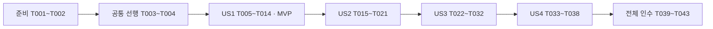

# 작업 목록: 예약 생성·성공한 키·롤백

**입력**: [명세](spec.md) · [계획](plan.md) · [조사](research.md) · [데이터 모델](data-model.md) · [생성 계약](contracts/reservation-create-contract.md) · [검증 안내](quickstart.md)
**작성일**: 2026-10-19
**상태**: 2026-10-19 구현 및 실행 인수 완료. 완료 표시는 작업별 실제 증거를 따른다.
**테스트**: 사용자 선택 범위·프로젝트 규칙이 TDD와 실제 PostgreSQL/HTTP 검증을 요구하므로 테스트 작업을 포함한다. 자동 OpenAPI validator의 본격 계약 테스트는9단계이며 이번 HTTP 계약 assertion과 구분한다.
**구성**: 준비→공통 선행→네 사용자 이야기→전체 검증. 문서 경로와 코드 경로는 모두 저장소 루트 기준이다. 나열한 신규 파일은 구현 예정이며 현재 존재를 뜻하지 않는다.

## 형식과 작업 원칙

`- [ ] T번호 [P 선택] [US번호 해당 시] 작업 설명과 정확한 경로`를 사용한다. [P]는 서로 다른 파일의 작성 병행 후보이며 테스트 실행·Gradle·공유 파일 수정·기록/커밋의 병행 허용이 아니다.

기능 기대값을 먼저 작성하고 필요한 최소 선언으로 실행 가능하게 만든 뒤 기능 실패를 확인한다. 이미 요구사항을 만족하는 기존 동작은 회귀 통과로 기록하며 RED를 만들려고 결함을 넣지 않는다. 각 최소 구현은 관련 검증과 기록 뒤 진행한다. 실패를 skip·기대값 변경·H2·DB mock·버전 하향으로 숨기지 않는다.

맞춤 요구사항 목록34개는 사용자 지시로 평가해 문서 품질34/34 충족 판정했다. 작업 생성과 품질 평가는 별개이며 이 판정은 구현·기능 테스트 통과를 뜻하지 않는다. 실행 스킬은 구현 시작 시 최신 체크 상태와 근거를 다시 확인하고 평가 마커를 임의 변경하지 않는다.

## Phase 1: 준비

기준과 현재 작업 상태를 확인한다. 새 기능·환경을 초기화하거나 기존 미커밋 문서를 덮어쓰지 않는다.
- [X] T001 knowledge/README.md·knowledge/rules/ 전체·관련 도메인·계획서 2~5절과 spec/plan을 대조하고 Git 최상위·HEAD·브랜치·기존 변경을 확인해 docs/test-evidence.md에 시작 상태와 구현용 작업 브랜치 선택을 기록한다. 문서 브랜치 변경을 보존하고 별도 외부 작업은 하지 않는다.
- [X] T002 specs/006-reservation-create/checklists/reservation-create.md의 검토자 소유권·최신34/34 품질 검토 결과와 specs/006-reservation-create/checklists/requirements.md의 별도 수명 주기를 확인하고 docs/test-evidence.md에 구현 게이트의 현재 상태를 기록한다. 평가 요청 없이 맞춤 마커를 바꾸지 않으며 미검토 관문은 완료로 간주하지 않는다.

## Phase 2: 공통 선행

기존 저장·실행 기반을 유지한다. 이 단계 뒤 US1부터 시작한다.
- [X] T003 backend/build.gradle에서 BOM 관리 PostgreSQL 드라이버를 runtimeOnly에서 implementation으로 이동하고 중복 testImplementation을 정리한다. 새 버전·라이브러리를 지정하지 않는다. 기존 Unit/IT 발견·0건/skip 거부 게이트를 보존하고 ./gradlew dependencies --configuration compileClasspath 결과를 docs/versions.md에 기록한다.
- [X] T004 backend/src/main/resources/db/migration/V1__create_reservation_schema.sql과 backend/src/test/java/com/limitedbooking/backend/support/ContainerTestSupport.java·TestData.java·DatabaseAssertions.java를 확인한다. 대상의 “UUID PK, 불변”, “varchar(100), 기존 입력 규칙”, “정수 0~1000, 불변”, “정수 0~capacity”, “timestamptz” 및 예약의 기존 FK/유일/CHECK를 보존한다. Docker/JDK25/동적 포트·테스트 DB 준비 가능 여부만 점검하고 docs/test-evidence.md에 기록한다. V1을 편집하거나 기존 마이그레이션을 재적용하지 않는다. 신규 세 IT의 동적 테스트 설정 계약을 spring.datasource.hikari.maximum-pool-size=10·spring.datasource.hikari.connection-timeout=3000으로 확정하고 T005·T015·T022 작성 시 각각 적용한다. local 프로필을 활성화해 개발 DB 설정을 가져오지 않는다.

## Phase 3: US1 — 남은 수량 한 개 예약하기 (P1, MVP)

**목표**: 한 개 생성·품절·대상 없음·다른 키 추가 예약을 제공한다.

**독립 인수**: 커밋된 capacity1 대상으로 인증 HTTP 생성 후 201·Location·false·CONFIRMED 행1·available0·보존식을 확인하고, capacity0/없는 대상을 각각 409/404로 구분한다. 다른 키는 충분한 수량에서 별도 성공한다.
- [X] T005 [US1] backend/src/test/java/com/limitedbooking/backend/reservation/ReservationCreateIT.java에 postgresOnly·RANDOM_PORT·실제 Authorization·TestData의 요청 전 커밋·종료 리스너를 재사용하여 createsFirstReservation 사례를 먼저 작성한다. 201/Location/JSON 네 필드/false·인증 UUID·available0·행1·단일 SELECT 보존식을 기대하며 테스트 전체 @Transactional은 사용하지 않는다. 동적 접속 정보와 함께 테스트 전용 풀 최대10·연결 획득 대기3000ms 설정을 명시한다.
- [X] T006 [US1] backend/에서 ./gradlew integrationTest --tests '*ReservationCreateIT.createsFirstReservation'을 실행해 기능 부재의 HTTP/상태 실패를 확인하고 docs/test-evidence.md에 명령·종료 코드·실행 수·실패 사유를 기록한다. 컴파일 오류라면 최소 선언만 추가해 실행 가능한 상태를 만든 뒤 확인하며 컴파일 실패 자체를 RED로 인정하지 않는다.
- [X] T007 [US1] backend/src/main/java/com/limitedbooking/backend/reservation/CreateReservationRequest.java·CreatedReservationView.java·CreateReservationResult.java를 record로 정의한다. resourceId는 “유일한 본문 필드이며 null/누락/형식 오류는 거부한다”, 생성 응답은 “최초/재현 모두 CONFIRMED. userId·key·cancelledAt는 포함하지 않는다”, 결과는 “최초 false, 기존 성공 재현 true”를 그대로 적용한다. 신규 입력 필드를 추가하지 않는다.
- [X] T008 [US1] backend/src/main/java/com/limitedbooking/backend/resource/ResourceRepository.java에 decrementIfAvailable(UUID): int, backend/src/main/java/com/limitedbooking/backend/reservation/ReservationRepository.java에 insert(...): StoredReservation을 추가한다. available>0 조건의 UPDATE와 CONFIRMED/null INSERT RETURNING을 사용한다. 예약 속성은 “UUID PK, 생성 후 불변”, “UUID FK resources(id), 필수·불변”, “인증 UUID, 필수·불변; 응답에 포함하지 않음”, “varchar(64), 필수·불변; IdempotencyKey에서 ASCII 영문/숫자/_/- 1~64 검증”, “varchar(16), CONFIRMED 또는 CANCELLED”, “timestamptz, 필수·불변, UTC 마이크로초”, “CONFIRMED이면 null, CANCELLED이면 필수 시각”을 유지한다.
- [X] T009 [US1] backend/src/main/java/com/limitedbooking/backend/reservation/ReservationWriter.java의 별도 public Bean create(UUID, UUID, IdempotencyKey): CreateReservationResult에 READ_COMMITTED 트랜잭션을 두고 SET LOCAL lock_timeout=2s·statement_timeout=5s, 조건부 차감·예약 저장을 함께 반영한다. UUID와 Clock 시각을 생성하고 MICROS 절삭·UTC 바인딩 후 RETURNING 행으로 최초 body/false를 만든다. 자기 호출·예외 삼킴·부분 커밋은 금지한다.
- [X] T010 [US1] backend/src/main/java/com/limitedbooking/backend/reservation/ReservationService.java의 동일 create 시그니처에서 트랜잭션을 시작하지 않고 상위 활성 트랜잭션을 fail-fast로 거부한 뒤 외부 Writer Bean을 호출한다. 우선 최초 생성 흐름만 구현하며 후속 키 선조회·유일 위반 복구는 US2/US3 작업에서 연결한다.
- [X] T011 [US1] backend/src/main/java/com/limitedbooking/backend/reservation/ReservationController.java에 POST /api/reservations를 연결한다. 인증 UUID는 LocalIdentityResolver에서 얻고 기존 IdempotencyKey를 사용한다. application/json·201·/api/reservations/{id} Location·Idempotent-Replayed와 body 네 필드를 변환하며 GET/취소를 구현하지 않는다.
- [X] T012 [US1] backend/src/test/java/com/limitedbooking/backend/reservation/ReservationCreateIT.java에 capacity0의 SOLD_OUT·없는 UUID의 NOT_FOUND·같은 사용자 다른 키의 추가 성공과 실패 키 비보존 사례를 작성하고 선택 실행한다. 미구현 사유의 실패 또는 이미 만족하는 회귀 결과를 docs/test-evidence.md에 구분 기록한다. 유효 키 K로 품절 대상 A에409를 받은 뒤 같은 사용자·K로 수량이 있는 대상 B에 요청해201·replayed=false·예약1개가 되는 사례를 포함한다. A의 수량/예약은 그대로이고 B에서만1개 소비되며 수량 변경 API를 추가하지 않는다.
- [X] T013 [US1] backend/src/main/java/com/limitedbooking/backend/reservation/ReservationWriter.java의 UPDATE0 경로에서 새 사용자/키 SELECT 후 성공 키가 없을 때 대상 find로 없음/품절을 나누고, backend/src/main/java/com/limitedbooking/backend/common/ApiExceptionHandler.java에 SOLD_OUT409를 연결한다. ResourceNotFoundException404를 재사용하며 불필요한 추가 예약·키 저장은 하지 않는다. UPDATE0의 기존 키 재현/충돌 분기는 US2에서 완성한다.
- [X] T014 [US1] backend/src/test/java/com/limitedbooking/backend/reservation/ReservationCreateIT.java의 US1 사례와 영향받는 저장소 테스트를 실행해 실제 발견 수·실패0·skip0·DB 보존식을 확인한다. docs/test-evidence.md에 결과와 남은 US2~US4 범위를 기록하고 knowledge/rules/commit.md에 맞춰 검증 대상별 로컬 커밋한다. MVP는 US1 범위만 뜻하며 5단계 전체 완료 표시는 하지 않는다. T012의 품절409 후 같은 키로 다른 대상 생성201/false와 양쪽 보존식도 실제 인수 결과에 포함한다.

## Phase 4: US2 — 같은 요청을 안심하고 다시 보내기 (P1)

**목표**: 성공 키 재현·충돌·키 격리·정밀도·취소된 준비 행의 재현을 제공한다.

**독립 인수**: 준비된 성공 예약에 같은/다른 대상을 요청해 201/409와 수량 무변경을 판정한다. 같은 키·다른 사용자는 별도 성공하며, 최초·재현·저장 시각이 같고 CANCELLED 준비 행의 현재 상태는 변하지 않는다.
- [X] T015 [P] [US2] backend/src/test/java/com/limitedbooking/backend/reservation/IdempotencyIT.java에 마지막 수량 동일 요청2회·다른 대상(충분/품절/없음) 충돌·다른 사용자 동일 키·같은 사용자 다른 키 및 대소문자 다른 키·JSON 공백/UUID 대소문자 변형을 작성한다. 테스트 전용 Primary 고정 Clock 2026-10-19T00:00:00.123456789Z와 보존식에 맞는 CANCELLED 준비 행을 사용해 정밀도/최초CONFIRMED 재현 사례도 포함한다. 동적 접속 정보와 함께 테스트 전용 풀 최대10·연결 획득 대기3000ms 설정을 명시한다.
- [X] T016 [P] [US2] backend/src/test/java/com/limitedbooking/backend/reservation/ReservationServiceTest.java에 Spring 없는 키 선조회→동일 대상 재현/다른 대상 충돌·없는 키의 Writer 호출 분기를 작성한다. 실제 키 값 객체의 원문 비교와 UUID 값 비교를 기대하고 대역은 조정 분기의 증거일 뿐 DB/HTTP 증거가 아님을 명시한다. 이 작업과 직전 IdempotencyIT 파일 작성만 병행 가능하다.
- [X] T017 [US2] backend/에서 IdempotencyIT·ReservationServiceTest의 추가 사례를 각각 선택 실행하여 키 재현 미구현의 RED를 확인한다. 기존 MICROS 처리 등 이미 만족하는 항목은 회귀 GREEN으로 기록하고 인위적인 결함을 만들지 않는다. 명령·사유·기대값을 docs/test-evidence.md에 기록한다.
- [X] T018 [US2] backend/src/main/java/com/limitedbooking/backend/reservation/ReservationService.java에 트랜잭션 밖 findByUserAndKey 선조회를 연결하고 동일 resourceId는 최초 결과/true, 다른 resourceId는 IDEMPOTENCY_CONFLICT로 처리한다. backend/src/main/java/com/limitedbooking/backend/common/ApiExceptionHandler.java에 해당409만 명시적으로 연결한다. 기존 키 비교를 현재 수량·대상 존재 검사보다 먼저 수행한다.
- [X] T019 [US2] backend/src/test/java/com/limitedbooking/backend/reservation/ReservationWriterTest.java에 UPDATE0 이후 새 키 조회의 동일 대상 재현·다른 대상 충돌·키 없음 뒤 대상 없음/품절 분기를 먼저 작성한다. Writer를 직접 호출하는 순수 테스트로 새 SELECT 호출 순서를 기대하고, 미구현 재현·충돌 분기의 기능 RED를 선택 실행해 docs/test-evidence.md에 기록한다. 기존 없음/품절 분기는 회귀 GREEN으로 구분하고 실제 경쟁 관측은7단계임을 명시한다.
- [X] T020 [US2] backend/src/main/java/com/limitedbooking/backend/reservation/CreatedReservationView.java·CreateReservationResult.java와 backend/src/main/java/com/limitedbooking/backend/reservation/ReservationWriter.java에서 T019의 실패를 해결하는 최소 재현·충돌 분기를 구현한다. StoredReservation의 불변 id/resourceId/createdAt·고정 CONFIRMED를 사용하고 UPDATE0 뒤 새 키 SELECT가 있으면 동일 대상 재현/다른 대상 충돌로 처리한다. CANCELLED·cancelledAt·수량은 변경하지 않고 키 TTL/실패 키 테이블을 추가하지 않는다. ReservationWriterTest와 관련 IdempotencyIT를 실행해 GREEN을 기록한다.
- [X] T021 [US2] backend/src/test/java/com/limitedbooking/backend/reservation/IdempotencyIT.java·ReservationServiceTest.java·ReservationWriterTest.java 및 US1 회귀를 실행한다. 고정 시각 저장/최초/재현이 ...123456Z로 같은지와 총 예약수·양쪽 수량·취소 준비 상태 불변을 확인해 docs/test-evidence.md에 실제 결과를 기록하고 검증 단위로 로컬 커밋한다.

## Phase 5: US3 — 실패 후 같은 키로 다시 시도하기 (P1)

**목표**: 저장 실패·정확한 유일 위반·의존성 장애에서 전체 롤백과 안전한 복구를 제공한다.

**독립 인수**: 실제 차감 후 INSERT 전 실패에서 종료 후 별도 연결로 available1·예약0·성공 키 없음, 주입 제거 후 같은 키201/false를 확인한다. 준비된 중복 키의 직접 Writer 실패도 수량 복구를 확인한다.
- [X] T022 [US3] backend/src/test/java/com/limitedbooking/backend/reservation/ReservationRollbackIT.java에 테스트 전용 Repository spy/래퍼를 작성한다. 실제 HTTP·Writer·UPDATE는 유지하고 같은 트랜잭션 연결로 available 감소를 관측한 뒤 INSERT 직전에 한 번 실패시킨다. HTTP500·별도 연결 available1/행0/키 없음·DatabaseAssertions와 주입 해제 후 같은 키201/false를 기대하고 주입 제어는 finally에서 정리한다. 동적 접속 정보와 함께 테스트 전용 풀 최대10·연결 획득 대기3000ms 설정을 명시한다.
- [X] T023 [US3] backend/에서 ReservationRollbackIT의 저장 실패·복구 사례를 실행해 docs/test-evidence.md에 결과를 기록한다. 기존 Writer가 이미 전체 롤백을 만족하면 통과한 회귀 증거로 남기며 가짜 RED를 만들지 않는다. 실패 시 원인 조사 뒤 backend/src/main/java/com/limitedbooking/backend/reservation/ReservationWriter.java·ReservationRepository.java의 트랜잭션 경계만 최소 수정해 재검증한다.
- [X] T024 [P] [US3] backend/src/test/java/com/limitedbooking/backend/common/UniqueViolationClassifierTest.java에 동일 예외의 23505+uq_reservations_user_key만 true, 다른PK23505/FK23503/연결08계열·메타데이터 없음·메시지만 일치·상태/이름이 서로 다른 예외·null·cause/nextException 순환은 false인 사례를 작성한다. 아직 없는 분류기는 실행 가능한 최소 false 골격까지만 둔다.
- [X] T025 [P] [US3] backend/src/test/java/com/limitedbooking/backend/reservation/ReservationServiceTest.java에 Writer 중복 오류 이후 새 조회의 같은 대상 재현/다른 대상 충돌·성공 행 없음 내부 오류·비대상 예외 전파·무제한 재시도 없음의 순서를 추가한다. 바로 앞 분류기 테스트 파일 작성과 병행 가능하며 운영 공유 파일 수정은 하지 않는다.
- [X] T026 [US3] backend/에서 UniqueViolationClassifierTest와 ReservationServiceTest의 US3 사례를 각각 실행해 분류/복구 미구현의 기능 RED를 확인하고 docs/test-evidence.md에 기록한다. 컴파일 오류만으로 완료하지 않는다.
- [X] T027 [US3] backend/src/main/java/com/limitedbooking/backend/common/UniqueViolationClassifier.java에 같은 PSQLException의 SQLSTATE23505·정확한 제약명을 함께 검사하고 cause/nextException을 identity 순환 방지로 순회하는 최소 분류를 구현한다. 문자열 파싱·부분 이름 일치·모든 DuplicateKeyException 처리 없이 분류기 Unit을 통과시킨다.
- [X] T028 [US3] backend/src/main/java/com/limitedbooking/backend/reservation/ReservationService.java에서 외부 Writer 프록시 예외가 돌아온 뒤 분류기 true일 때만 새 키 조회로 재현/충돌한다. 기존 성공이 없으면 IllegalStateException, 다른PK/FK/연결 오류는 원래 예외 전파다. Writer 내부 catch/조회·REQUIRES_NEW·자동 반복 재시도를 추가하지 않는다.
- [X] T029 [US3] backend/src/test/java/com/limitedbooking/backend/reservation/ReservationRollbackIT.java에 충분한 수량·기존 성공 키를 준비하고 Spring 주입 Writer를 직접 호출해 실제 UPDATE 후 대상 유일 위반과 전체 롤백·구조화 메타데이터를 대조한다. 상위 TransactionTemplate 안 Service 호출의 fail-fast·무변경도 검사한다. 준비 데이터와 검증 관측은 별도 커밋/연결로 분리하며 실제 동시성 증거로 기록하지 않는다.
- [X] T030 [US3] backend/src/test/java/com/limitedbooking/backend/reservation/ReservationRollbackIT.java에 독립 잠금 연결의 lock timeout, 테스트 래퍼의 문장 지연 timeout, Writer 시작 연결 획득 실패를 각각 작성·실행한다. 유한 대기·503·전체 무변경·원인 해제 후 동일 키201을 기대한다. 실제 쓰기를 mock으로 대체하지 않고 잠금/연결/지연 주입을 finally로 정리한다. 결과를 docs/test-evidence.md에 기록한다. 장애 주입 전에 실제 DataSource의 maximumPoolSize=10·connectionTimeout=3000ms를 확인하고, 응답이 정확히3초여야 한다고 단정하지 않는다. 명시한 유한 상한 안의503·무변경·원인 해제 후 같은 키201/false를 판정 기준으로 삼는다.
- [X] T031 [US3] backend/src/main/java/com/limitedbooking/backend/common/ApiExceptionHandler.java에서 기존 DB/timeout503을 보존하며 CannotCreateTransactionException의 실제 연결 획득 실패만 좁혀503으로 연결한다. 필요 시 backend/src/main/java/com/limitedbooking/backend/reservation/ReservationWriter.java의 SET LOCAL 적용과 롤백 경계를 수정한다. 내부 불변식·다른 제약·미분류 TransactionException을409/503으로 숨기지 않는다.
- [X] T032 [US3] backend/src/test/java/com/limitedbooking/backend/reservation/ReservationRollbackIT.java·ReservationServiceTest.java 및 backend/src/test/java/com/limitedbooking/backend/common/UniqueViolationClassifierTest.java를 실행하고 영향받는 US1/US2를 확인한다. 실패 주입 원복·별도 연결 수량/키 검사·예외 분류·유한 종료를 docs/test-evidence.md에 기록하고 통과한 검증 단위로 로컬 커밋한다.

## Phase 6: US4 — 잘못된 요청을 데이터 변경 없이 거부하기 (P2)

**목표**: 기존 입력·인증·공통 오류 계약을 생성 경로에 연결한다.

**독립 인수**: 유효한 생성 요청에서 인증·키·본문을 하나씩 바꾼 실제 HTTP 결과와 데이터 무변경을 비교한다. 올바른 인증의 임의 헤더는 소유자를 바꾸지 않는다.
- [X] T033 [US4] backend/src/test/java/com/limitedbooking/backend/reservation/ReservationCreateIT.java에 무자격/오류 자격401·세 계정의 생성·임의 X-User-Id 무시·본문userId/quantity400, 키 누락/빈 값/1·64허용/65거부/공백/비ASCII/기호, resourceId 누락/null/오류UUID·빈/깨진JSON·중복/알 수 없는 필드 사례를 작성한다. 거부 뒤 예약·키·수량 무변경을 함께 기대한다. 유효 키 K와 잘못된 본문으로400을 받은 뒤 본문만 바로잡아 같은 사용자·K로 재요청해201·replayed=false·예약1개가 되는 사례를 추가한다. 최초400 뒤 키/예약 없음·수량 불변을 먼저 확인하고 무효 키를 다른 문자열로 고치는 사례와 구분한다.
- [X] T034 [US4] backend/에서 ReservationCreateIT의 입력·인증 사례를 선택 실행해 docs/test-evidence.md에 미구현 RED와 기존 공통 처리로 이미 통과한 회귀를 구분 기록한다. 거부된400/401을 품절409로 바꿔 통과시키지 않는다.
- [X] T035 [US4] backend/src/main/java/com/limitedbooking/backend/reservation/CreateReservationRequest.java·ReservationController.java에서 null/누락/잘못된 UUID와 기존 IdempotencyKey 원문 규칙을 실제 경로에 적용하고 기존 엄격 JSON·인증 UUID 처리를 재사용한다. 필요한 오류 변환만 backend/src/main/java/com/limitedbooking/backend/common/ApiExceptionHandler.java에 추가하며 요청 수량·사용자 지정 필드를 받지 않는다.
- [X] T036 [US4] backend/src/test/java/com/limitedbooking/backend/reservation/ReservationCreateIT.java에 8192바이트 본문 전달/8193초과413(길이 헤더·생략·chunked), 미인증 초과413와 상한 이하401, 지원하지 않는 형식415·성공 키에 잘못된 입력을 섞은 경우의 인증/입력 우선순위, 공통 오류 필드·WWW-Authenticate·민감정보 비노출 사례를 작성·실행한다. 사유별 계약을 specs/006-reservation-create/contracts/reservation-create-contract.md와 대조한다.
- [X] T037 [US4] backend/src/main/java/com/limitedbooking/backend/reservation/ReservationController.java·CreateReservationRequest.java·backend/src/main/java/com/limitedbooking/backend/common/ApiExceptionHandler.java에서 남은 입력/오류 결함만 최소 수정한다. 기존 RequestBodyLimitFilter·SecurityConfig는 관련 실패 근거가 있을 때만 수정하고, 500의 비노출은 유지하되 고정 계약에 없는 새 오류 code를 추가하지 않는다. 취소·Redis 기능은 추가하지 않는다.
- [X] T038 [US4] backend/src/test/java/com/limitedbooking/backend/reservation/ReservationCreateIT.java의 US4 및 영향받는 backend/src/test/java/com/limitedbooking/backend/security/SecurityIT.java·resource/ResourceApiIT.java를 실행해 실제 인증 경로·오류 우선순위·무변경을 확인한다. 실패0·skip0·실행 수·기존 처리를 재사용한 범위를 docs/test-evidence.md에 기록하고 검증 단위로 로컬 커밋한다. T033의 유효 키·잘못된 본문400 후 같은 키·정상 본문201/false와 최종 예약1개도 실제 인수 결과에 포함한다.

## Phase 7: 전체 검증·정리

US1~US4를 하나의 5단계 결과로 인수한다. 실행·문서·커밋은 순차 처리한다.
- [X] T039 backend/에서 ./gradlew test integrationTest --tests '*ReservationCreateIT' --tests '*IdempotencyIT' --tests '*ReservationRollbackIT'을 실행한다. backend/build/test-results/test·integrationTest의 현재 XML과 listener에서 전체Unit·지정3IT의 실제 발견·실패0/오류0/skip0를 확인하고 docs/test-evidence.md에 명령·종료 코드·종류별 수를 기록한다.
- [X] T040 backend/에서 ./gradlew verify를 실행해 기존 Unit·일반IT 회귀를 인수한다. backend/build/test-results/test·integrationTest와 docs/test-evidence.md에 실제 수·환경·종료 코드·미검증을 남긴다. 새 수정·실패·우려가 없으면 무거운 심화·부하를 불필요하게 반복하지 않는다.
- [X] T041 README.md·docs/versions.md·docs/decisions.md·docs/test-evidence.md와 knowledge/domain/reservation.md·resource.md·security.md·knowledge/README.md를 실제 구현·실행 범위에 맞춘다. docs/openapi.yaml과 specs/006-reservation-create/contracts/reservation-create-contract.md의 상태/필드/헤더를 대조하고 기존 정책을 바꾸지 않는다. 실행 안내와 실제 증거·예정 파일을 구분한다.
- [X] T042 specs/006-reservation-create/quickstart.md·plan.md와 한정 수량 예약 백엔드 로컬 개발 계획.md의5단계 체크를 실제 수행 증거에 맞춰 갱신한다. specs/006-reservation-create/tasks.md는 완료 작업만 체크하고 맞춤 checklists/reservation-create.md는 검토자 판정 없이 변경하지 않는다. 문서 링크·git diff --check·실패 주입 운영 코드 부재를 확인한다.
- [X] T043 knowledge/rules/commit.md·git-flow.md에 따라 최상위·브랜치·변경범위를 확인하고 명시한 파일만 스테이징해 잔여 검증 대상별 로컬 커밋을 남긴다. docs/test-evidence.md에 최종 검증·미완료·핵심 코드/SQL/테스트·다음6단계를 기록한다. develop병합·push·공개·외부CI는 별도 지시 없이 수행하지 않는다.

## 의존성과 실행 순서

- US1은 선행 완료 후 시작한다. US2는 US1의 실제 생성 경로, US3는 US1의 실제 Writer와 US2의 재현/충돌 결과를 사용한다. US4는 동일 생성 경로를 재사용한다. 공유 Controller/Service/Writer/핸들러를 여러 이야기가 수정하므로 이야기 구현은 순차 처리한다.
- 각 이야기는 그 단계까지의 코드와 독립적으로 커밋한 준비 데이터로 인수 가능하다. 후속 취소·경쟁·Redis API 구현을 전제하지 않는다. 사용자 이야기들이 빈 저장소에서 서로 무관하게 구현 가능하다는 뜻은 아니다.
- US1 내부는 T005→T006(RED)→T007~T011(최초 최소 구현)→T012(추가 기대값)→T013(오류 최소 구현)→T014다.
- US2는 T014 이후 T015/T016 작성 병행→T017 RED→T018 Service 선조회 구현→T019 Writer 분기 테스트·RED→T020 Writer 최소 구현·GREEN→T021 순서다. 실제 정밀도 처리가 이미 구현됐다면 T017의 해당 항목은 회귀 통과 증거로 기록한다.
- US3는 T021→T022/T023 실제 저장 실패 확인→T024/T025 작성 병행→T026 RED→T027/T028 구현→T029/T030 실제 경계·장애 검사→T031 최소 오류 처리→T032 순서다. T030의503이 기존 처리로 이미 충족되면 그 결과를 보존한다.
- US4는 T032→T033/T034 기대값·실행→T035→T036 추가 기대값·실행→T037 필요한 최소 수정→T038이다.
- T039→T040→T041→T042→T043은 순차 실행한다. 마감 중 동작 변경이 필요하면 관련 RED/최소 수정/회귀와 전체 영향 검증을 마친 뒤 실제 기록을 갱신한다.

## 사용자 이야기별 병행 예시

| 이야기 | 같은 선행 완료 후의 예시 | 제한 |
| --- | --- | --- |
| US1 | 작성 병행 후보 없음. T005 최초 HTTP 기대값을 먼저 확정하고 구현을 순서대로 연결한다. | DTO·Repository·Writer 작성이 최초 RED보다 앞서지 않음 |
| US2 | T015 IdempotencyIT.java 작성과 T016 ReservationServiceTest.java 작성 | 선행 T014; 운영 Service/Writer/핸들러 변경과 Gradle 실행은 순차 |
| US3 | T024 UniqueViolationClassifierTest.java 작성과 T025 ReservationServiceTest.java 추가 작성 | 선행 T023; 최소 컴파일 골격은 테스트 작성 조율 후 순차 적용 |
| US4 | 작성 병행 후보 없음. US1과 같은 ReservationCreateIT.java를 확장한다. | 공유 파일 동시 편집 금지 |

[P]는 병행 가능성의 표시이며 이 문서 생성 과정에서 병행 구현을 수행했다는 뜻이 아니다. 실제 구현은 프로젝트가 요구하는 `superpowers:executing-plans` 또는 `superpowers:subagent-driven-development` 절차를 따른다.

## 요구사항·계약 추적

| 범위 | 주 작업 | 관련 인수 |
| --- | --- | --- |
| FR-001~004, SC-001의 최초 생성 | T005~T014 | US1 HTTP·예약/수량·404/409 |
| FR-005~008, SC-001~002 | T015~T021 | 사용자/키 격리·재현/충돌·취소 준비 상태 불변 |
| FR-009, SC-004 | T009·T015~T021 | 고정 Clock·DB 저장값·최초/재현 시각 |
| FR-010~011, SC-003 | T022~T032 | 실제 롤백·정확한 제약 분류·새 조회·같은 키 복구 |
| FR-012, SC-005 | T030~T038 |503/500 구분·실제 인증·엄격 입력·오류/크기 우선순위 |
| 내부 Service/Writer/분류기 인터페이스 | T009~T011·T016~T020·T024~T029 | 조정 분기·실제 Writer 경계·분류 정확성 |
| 기존 V1 제약·불변 속성 | T004·T008·T029 | 스키마 보존·실제 저장 메타데이터·별도 관측 |
| 전체 발견/증거/문서 계약 | T039~T043 | 지정3IT·일반verify·현재 실행XML·실제 문서 상태 |

## 구현 전략

1. 준비·선행 후 **US1만 최초 MVP**로 검증한다. 이 지점은 최초 생성·품절·대상 없음·다른 키 추가 예약까지이며 5단계 전체 정합성 인수가 끝난 상태는 아니다.
2. US2의 성공 키 재현을 추가하고 US1을 회귀 확인한다. 취소된 상태는 준비 데이터로만 만들며 실제 취소 API를 구현하지 않는다.
3. US3에서 이미 있는 트랜잭션의 원자성을 실제 실패로 검증하고 정확한 중복 오류 분류·롤백 뒤 새 조회·timeout/연결 장애를 연결한다. 순수 조정 검증과 실제 DB 증거를 구분한다.
4. US4에서 경계·오류·인증을 보완하고 전체 인수를 수행한다. 매 기능 대상은 관련 기대값 작성·실행·최소 수정·검증·기록의 작은 단위로 진행한다.
5. 각 이야기 종료 시 실제 증거를 기록하고 로컬 검증 단위별 커밋한다. 전체 작업 완료 뒤에만 계획서 5단계의 해당 체크를 갱신한다.

## 주의사항

- 저장 실패 주입은 테스트 파일 안에만 둔다. 운영 API·환경 변수·테스트 플래그를 추가하지 않는다.
- lock2s·statement5s·풀10/획득3s를 임의 완화해 통과시키지 않는다. 독립 잠금·Future·HTTP 요청에는 유한 상한과 정리가 필요하다.
- 직접 Writer의 충분한 수량 유일 위반과 순수 UPDATE0 분기는 실제 마지막 수량/동일 키 경쟁의 실행 증거가 아니다. 7단계의 실제 경쟁 반복은 필수 후속이다.
- 일반 verify는 자동 계약·Property·PIT·부하 전체가 아니다. 테스트0건·skip은 성공이 아니며 실행하지 않은 검증을 완료 체크하지 않는다.
- 체크리스트 요구사항 품질 승인, 작업 수행 완료, 계획서의 단계 인수를 서로 구분한다. 총43개 작업의 실제 수행 결과는 위 완료 표시와 docs/test-evidence.md를 따른다.

최종 독립 리뷰의 UUID 입력 보완 후에도 T001~T043 완료다. 지정 Unit137/IT28 및 일반verify Unit137/IT120(실패·오류·skip0), 문서 링크264/누락0을 확인했다. 재현/수정 내역은 docs/test-evidence.md를 따른다.
