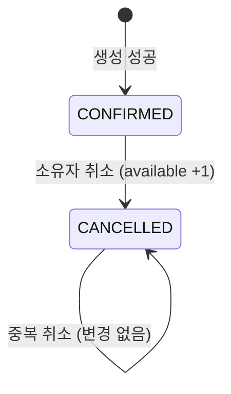

# 데이터 모델: 소유자의 예약 조회·취소

스키마 변경은 없다(V1 유지).

## reservations (기존)
| 필드 | 규칙 |
| --- | --- |
| id, resource_id, user_id, idempotency_key, created_at | 생성 후 불변 |
| status | `CONFIRMED` → `CANCELLED`만 허용, 역전이·삭제 없음 |
| cancelled_at | CONFIRMED면 null, CANCELLED면 값(UTC, 마이크로초). 한 번 기록되면 불변 |

## resources (기존)
- `0 ≤ available ≤ capacity`, `available + count(CONFIRMED) = capacity`.
- 취소 1건이 성공하면 available이 +1 된다(`available < capacity` 조건).

## ReservationView (신규 응답 record)
`ReservationView(UUID id, UUID resourceId, ReservationStatus status, Instant createdAt, Instant cancelledAt)`. `cancelledAt`은 항상 직렬화하며 확정 상태에서는 null이다(OpenAPI required).

## 상태 전이

## Repository 추가 (예정)
- `ReservationRepository.findByIdAndUser(id, userId): Optional<StoredReservation>`
- `ReservationRepository.markCancelled(id, userId, cancelledAt): int` — `status='CONFIRMED'` 조건
- `ResourceRepository.lockForUpdate(resourceId)` — `SELECT id FROM resources WHERE id=:id FOR UPDATE`
- `ResourceRepository.incrementIfBelowCapacity(resourceId): int`
