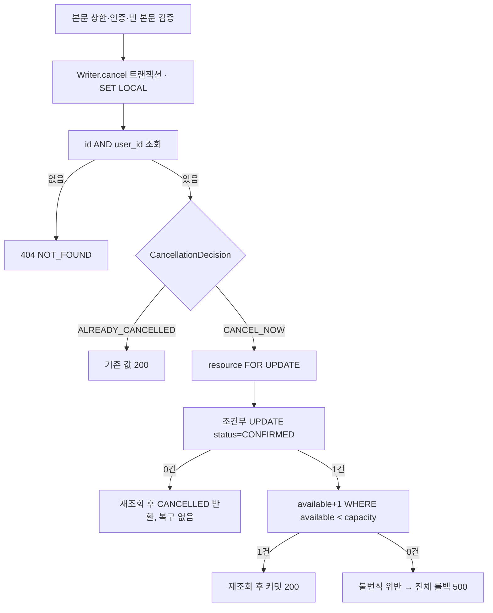

# 구현 계획: 소유자의 예약 조회·취소

**작업 Git 브랜치**: 설계 `docs/reservation-cancel-spec`, 구현 `feature/reservation-cancel` | **작성일**: 2026-10-20 | **명세**: [spec.md](spec.md)

**입력**: `specs/007-reservation-cancel/spec.md`, 로컬 개발 계획 2~5절(5.3 취소 흐름)·7절 6단계.

**상태**: Phase 0/1 설계와 전체 구현·검증을 완료했다(2026-10-20). 실제 브랜치는 `feature/reservation-cancel`이며 구현 커밋은 `5b4019c`다. 신규 OwnershipIT5·CancelIT13, 전체 Unit137·일반IT138과 local curl11단계를 통과했다. [실행 증거](../../docs/test-evidence.md)를 따른다. 아래 설계 시점 상태·예정 구조는 당시 기준이며 현재 구현은 소스와 실행 증거를 따른다.

## 요약

소유자는 자신의 예약을 단건 조회하고 취소한다. 타인 예약과 없는 예약은 관리자에게도 똑같이 404 `NOT_FOUND`다. 취소는 별도 Writer Bean의 READ COMMITTED 트랜잭션에서 처리한다. 순서는 소유자 예약 조회 → (확정이면) 대상 `FOR UPDATE` → 조건부 상태 UPDATE → 갱신이 1건이면 `available < capacity` 조건으로 복구다. 복구가 0건이면 불변식 위반으로 전체를 롤백한다. 이미 취소된 예약은 `CancellationDecision.ALREADY_CANCELLED` 분기에서 기존 값을 반환한다. [조사](research.md), [데이터 모델](data-model.md), [계약](contracts/reservation-cancel-contract.md), [검증 안내](quickstart.md)를 함께 본다.

## 기술 맥락

- **언어/빌드**: Java 25(preview 제외), 기존 Gradle Wrapper 9.7.1. 의존성 추가·변경 없음.
- **주요 의존성**: Boot 4.1.1 MVC/Security/JDBC, `NamedParameterJdbcTemplate`, 기존 PostgreSQL 드라이버.
- **저장소**: 기존 V1 스키마(`reservations` CHECK: CONFIRMED↔cancelled_at null). 새 마이그레이션 없음. Redis 미사용(요청 제한은 8단계).
- **검증**: Jupiter/AssertJ/Testcontainers 기반 실제 PostgreSQL, RANDOM_PORT HTTP와 실제 Basic Authorization. 신규 `ReservationCancelIT`·`ReservationOwnershipIT`, 필요하면 순수 `ReservationServiceTest`·`ReservationWriterTest` 보강.
- **제약**: 트랜잭션 시작 시 `SET LOCAL lock_timeout '2s'`·`statement_timeout '5s'`. 풀 최대 10·획득 대기 3초를 신규 IT에도 명시. 취소 본문 비어 있지 않으면 400(기존 필터), 8KiB 초과 413.
- **규모/범위**: 단건 조회·취소만. 목록·재활성화·삭제·경쟁 반복(7단계)·Redis 제한(8단계) 제외.
- **설계 당시 상태(2026-10-20 구현 전 확인)**: `ReservationStatus`·`StoredReservation`·`CancellationDecision`(Unit 검증만, 요청 경로 미연동)·`findByUserAndKey`·`decrementIfAvailable`·취소 본문 검증 필터는 있다. GET/cancel Controller·Service·Writer 메서드, `ReservationView`, 소유자 조회 SQL, 대상 잠금/복구 SQL은 없다.

## 헌법 점검

| 관문 | 조사 전 | 설계 후 근거 |
| --- | --- | --- |
| I. 서비스 경계·계약 보존 | 충족 | Controller→Service→Writer(cancel 트랜잭션)→Repository. OpenAPI의 GET/cancel 200·400/401/404 계약 그대로 사용 |
| II. 문서·코드 대조 | 충족 | 계획서 5.3, knowledge 규칙·예약 도메인, 실제 Java·SecurityConfig·openapi 대조 |
| III. 검증·증거 | 충족 | HTTP 기대값 RED → 최소 구현 → GREEN. 복구 실패 주입은 테스트 전용 래퍼, 0건·skip 금지 |
| IV. 문서 동기화 | 충족 | 정책 변경 없음. 구현 후 예약 도메인·test-evidence·계획서 체크박스를 실행 근거로 갱신 |
| V. 미확정 정책 | 충족 | clarify 질문 0개. 조회의 트랜잭션 미사용은 계획서 범위 안의 설계 선택(research R3) |

## 프로젝트 구조

### 기능 문서

```text
specs/007-reservation-cancel/
  spec.md  plan.md  research.md  data-model.md  quickstart.md
  contracts/reservation-cancel-contract.md
  checklists/requirements.md
  tasks.md   # 후속 $speckit-tasks
```

### 소스 구조와 변경 책임 (예정)

| 위치 (`backend/src/` 기준) | 책임·변경 |
| --- | --- |
| `main/.../reservation/ReservationController.java` | `GET /{id}`, `POST /{id}/cancel` 추가, 인증 UUID 전달 |
| `main/.../reservation/ReservationView.java` (신규) | 현재 상태 응답 record, `cancelledAt` 항상 직렬화(null 포함) |
| `main/.../reservation/ReservationService.java` | `get`(소유자 조회·없으면 404), `cancel`(Writer 위임) |
| `main/.../reservation/ReservationWriter.java` | `cancel` 트랜잭션: SET LOCAL·조회·Decision·잠금·UPDATE·복구·재조회 |
| `main/.../reservation/ReservationRepository.java` | `findByIdAndUser`, `markCancelled` 추가, 행 매핑 공통화 |
| `main/.../resource/ResourceRepository.java` | `lockForUpdate`, `incrementIfBelowCapacity` 추가 |
| `main/.../common/ApiExceptionHandler.java` | `ReservationNotFoundException` → 404 `NOT_FOUND` |
| `test/.../reservation/ReservationOwnershipIT.java` (신규) | 본인 200, 타인·관리자·없는 UUID 404(GET/cancel), 401, 잘못된 UUID 400 |
| `test/.../reservation/ReservationCancelIT.java` (신규) | 취소·중복 취소·원 키 재현·품절 키 재시도·복구 실패 롤백·복구 0건 불변식 |

## Phase 0: 조사 결과

[research.md](research.md) 참조. 새 업무 정책 질문은 없다.

## Phase 1: 취소 흐름과 검증 설계



1. **소유권(US1, 2.3)**: `ReservationOwnershipIT`에 기대값을 먼저 작성하고, 기능 부재로 인한 HTTP 실패(404/405 등)를 RED로 확인한 뒤 조회를 구현한다.
2. **취소(US2)**: capacity=1 생성 → 취소 → 200/CANCELLED/cancelledAt≠null/available=1, 보존식을 검사한다. 이어서 GET이 같은 값을 반환하는지 확인한다.
3. **중복 취소(US3.1)**: 두 번째 취소가 200이고 cancelledAt이 같으며 available=1인지 검사한다.
4. **롤백(US3.2~3.3)**: 테스트 래퍼(`@MockitoSpyBean` ResourceRepository)로 복구를 예외 처리해 500과 CONFIRMED·cancelled_at null·available=0을 확인한다. 복구 0건을 반환하도록 주입해 내부 오류와 롤백도 확인한다.
5. **취소 후 생성(US4)**: 원래 키로 다시 생성하면 201/replayed=true/CONFIRMED이고 GET은 CANCELLED인지 본다. 품절 409였던 다른 키가 취소 후 201/false인지도 확인한다.
6. **마감**: quickstart의 지정 IT와 일반 verify를 실행하고 CLI 1회 전체 실행을 기록한다. 이어서 문서·증거를 갱신하고 검증 대상별로 커밋한다.

동시 취소 10건과 생성·취소 경쟁은 7단계다. 이번 단계에서 잠금 순서는 코드 리뷰와 단일 요청 경로로만 확인하며, 경쟁 검증을 완료했다고 기록하지 않는다.

## 복잡성 추적

정당화가 필요한 헌법 위반은 없다.
