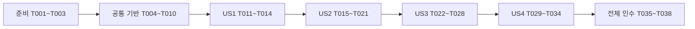

# Tasks: 동시 요청의 예약 정합성 검증

**Input**: `specs/008-reservation-concurrency/`의 [명세](spec.md)·[계획](plan.md)·[조사](research.md)·[모델](data-model.md)·[계약](contracts/concurrency-contract.md)·[검증 안내](quickstart.md).

**Prerequisites**: 설계 문서와 확정된 생성 성공/품절 두 순서를 유지한다. 작업 루트는 `/Users/joypeb/Desktop/projects/limited-booking-concurrency-plan`이며 경로는 이 루트 기준이다. 현재 문서는 작업 생성 결과이며 모든 구현·실행 작업은 미완료다.

**Tests**: 명세가 실제 경쟁 검증을 요구하므로 테스트를 포함한다. 기능은 테스트→의도한 실패 탐지→최소 수정→재검증 순서다. 기존 동작이 맞으면 추가 제품 변경 없이 고의 방어 훼손 탐지를 기록하고 반드시 원복한다. 컴파일 오류·미작성 관측 지원을 업무 RED로 취급하지 않는다.

**Organization**: US1(P1)·US2(P1)·US3(P1)·US4(P2) 순서이며 공통 지원을 먼저 만든다. 실제 구현에는 superpowers:executing-plans 또는 superpowers:subagent-driven-development 절차를 적용한다. 이번 tasks 생성은 구현을 시작하지 않는다.

## Format and Path Conventions

`- [ ] Tnnn [P?] [USn?] 설명과 정확한 파일 경로`를 사용한다. [P]는 다른 파일의 독립 작성만 뜻하고 Gradle·공유 파일·DB 실행 병행을 뜻하지 않는다. 신규 파일은 아래 작업에서 구현 예정이며 현재 존재한다고 가정하지 않는다. 생략된 제품 경로는 `backend/src/main/java/com/limitedbooking/backend/` 아래다.

## Phase 1: 준비

기존 작업·버전·기준을 확인한다. 신규 프로젝트나 의존성을 만들지 않는다.

- [ ] T001 기존 worktree·브랜치·HEAD·활성 기능을 확인하고 specs/008-reservation-concurrency/plan.md와 specs/008-reservation-concurrency/spec.md를 대조한다. 현재 작업 브랜치를 보존하며 구현을 별도 브랜치에서 할 경우 기존 명세 커밋을 유지한다.
- [ ] T002 knowledge/README.md의 목록·모든 rules 및 reservation/resource/security 도메인과 계획서2~5절/7단계, docs/openapi.yaml을 읽고 C01~C11 기대값·확정 두 순서·이번 범위를 docs/test-evidence.md에 준비 기록으로 남긴다.
- [ ] T003 backend/gradle/wrapper/gradle-wrapper.properties를 변경하지 않고 backend에서 java --version·./gradlew --version·docker version 및 기존 backend/build.gradle 발견 계약을 확인해 실제 실행 폴더/버전과 원래 폴더의 사용자 변경 차이를 docs/versions.md에 기록한다.

## Phase 2: 공통 기반

모든 사용자 이야기의 선행 조건이다. 지원 동작의 실패 탐지와 실제 DB 검증을 마친 뒤 진행한다.

- [ ] T004 [P] backend/src/test/java/com/limitedbooking/backend/support/ConcurrencyTestSupportTest.java에 제한된 작업자·첫 min(N,10) 준비 후 시작·100건 큐 처리·공통 deadline·예외/timeout 수집·장벽 실패·작업 종료 실패·정리 예외 보존·다음 회차 차단의 의미 있는 Unit을 먼저 작성한다. 구현 전 의도한 동작 실패를 확인하며 컴파일 오류를 RED로 기록하지 않는다. 클래스 단위 종료 실패 상태의 회차 간 유지·최초 원인 보존·다음 setup 차단과 reset/준비/요청 제출 각각0회 검증을 포함한다.
- [ ] T005 [P] backend/src/test/java/com/limitedbooking/backend/support/DatabaseSupportIT.java에 두 대상/예약0건/CONFIRMED·CANCELLED 혼합의 단일 snapshot, 수량 불일치·누락 대상·빈 ID 목록 거부 사례를 먼저 작성한다. “여러 대상도 단일 SELECT로 얻고 대상 누락·음수·불일치 실패”, “입력 ID와 결과 ID 집합이 일치해야 한다”, “빈 목록은 입력 오류로 거부한다”를 기대값으로 고정한다.
- [ ] T006 backend/src/test/java/com/limitedbooking/backend/support/ConcurrencyTestSupport.java에 실행·장벽·Future 수집·사건 기록·종료 지원을 최소 구현한다. 모델 제약 “회차별 독립 대상·키·관측기”, “제출 수와 결과 수 동일, 비밀번호·Authorization 원문 저장 금지”, “선조회/차감/INSERT 예외/재조회·커밋 완료 증거 구분”, “종료 확인 전 reset/다음 회차 금지”를 적용하고 지원 Unit을 실행한다. T004 이후 수행한다. 원자적으로 최초 종료 실패를 저장하고 보호 검사에서 다시 실패시키는 클래스 실행 범위의 차단 상태를 구현한다. 회차 초기화로 해제하지 않는다.
- [ ] T007 backend/src/test/java/com/limitedbooking/backend/support/DatabaseAssertions.java에 다중 대상 capacity/available/totalCount/confirmedCount를 단일 LEFT JOIN 집계로 반환하는 snapshot을 구현한다. “0≤available≤capacity≤1000; available+CONFIRMED 수=capacity”를 검사하고 기존 단건 API를 보존한다. T005의 실제 DB 실패를 확인한 뒤 구현·재검증한다.
- [ ] T008 backend/src/test/java/com/limitedbooking/backend/reservation/ReservationConcurrencyIT.java에 RANDOM_PORT·postgresOnly·실제 Basic HTTP·풀10/3000ms·UTC·회차별 준비/종료·장벽/Spy 초기화를 구성한다. 테스트 전체에 @Transactional을 붙이지 않고 준비는 요청 전에 커밋한다. 기존 reservation/ReservationApiTestSupport.java와 ContainerTestSupport를 재사용한다. backend/src/test/java/com/limitedbooking/backend/reservation/ReservationApiTestSupport.java의 부모 setup 첫 동작에 기본 무동작 protected 보호 검사를 추가하고 경쟁 클래스에서 재정의한다. 자식 @BeforeEach 대신 부모 reset 전에 검사한다. setup 차단으로 client가 없으면 부모 cleanup은 null을 처리하고 경쟁 cleanup은 해당 회차 소유 자원만 정리한다. 기존 테스트의 기본 동작은 유지한다.
- [ ] T009 backend/src/test/java/com/limitedbooking/backend/support/ConcurrencyTestSupport.java와 backend/src/test/java/com/limitedbooking/backend/reservation/ReservationConcurrencyIT.java에 장벽5초·HTTP9/10초·100건 회차120초/그 외30초·Executor/HTTP 종료 각10초·서버 in-flight0 확인10초를 연결한다. finally releaseAll→종료 확인→Spy 초기화→HTTP 종료, 정리 실패 suppressed 보존과 reset 금지를 적용한다. Hikari active 연결10ms 표본과 실제 풀/DB 설정 관측을 추가한다. Executor·서버·HTTP 종료 확인 중 하나라도 실패하면 최초 원인을 클래스 단위 차단 상태에 보존한다. 이후 setup은 reset·준비·요청 제출 전에 실패하고 상태는 회차 간 해제하지 않는다. JUnit 전체 중단에 의존하거나 후속 회차를 skip으로 숨기지 않는다.
- [ ] T010 지원 Unit·backend/src/test/java/com/limitedbooking/backend/support/DatabaseSupportIT.java와 공통 설정의 최소 실행을 수행하고 명령·종료 코드·실제 수·RED/GREEN·환경·정리 검증을 docs/test-evidence.md에 기록한다. 테스트0건/skip은 실패이며 이 게이트 전 업무 경쟁 사례를 진행하지 않는다.

## Phase 3: US1 — 한정 수량 초과 방지 (P1, MVP)

독립 인수: C01을10회 실행해 각 회차 201×10·SOLD_OUT×90·confirmed10·available0과 모든 작업 종료를 확인한다.

- [ ] T011 [US1] backend/src/test/java/com/limitedbooking/backend/reservation/ReservationConcurrencyIT.java에 C01 @RepeatedTest(10)을 먼저 작성한다. capacity10·고정 사용자/다른 키 조합100건·작업자10을 사용하고 최초 작업자 준비 후 시작을 해제한다. 정확한 HTTP 분포와 모든 요청 종료 뒤 snapshot·사용자키 최대1행을 검사한다. FR-001/006~008, SC-001.
- [ ] T012 [US1] C01 탐지력을 backend/src/test/java/com/limitedbooking/backend/reservation/ReservationConcurrencyIT.java로 확인한다. 기존 구현이 통과하면 backend/src/main/java/com/limitedbooking/backend/resource/ResourceRepository.java의 available>0 방어만 임시 고의 변경하여 예상 결과 실패를 관측하고 즉시 원복한다. docs/test-evidence.md에 실제 결함과 고의 결함을 구별한다.
- [ ] T013 [US1] C01에 실제 결함이 있으면 backend/src/test/java/com/limitedbooking/backend/reservation/ReservationConcurrencyIT.java의 실패 근거에 한해 해당 resource/ResourceRepository.java 또는 reservation/ReservationWriter.java를 최소 수정하고, 없다면 제품 변경 없이 시험을 정리한다. 모든 제출 결과 수집과 “제출 수와 결과 수 동일”을 재확인한다.
- [ ] T014 [US1] backend/src/test/java/com/limitedbooking/backend/reservation/ReservationConcurrencyIT.java의 C01 지정 실행10회와 영향받는 기존 예약 생성 시험을 수행해 docs/test-evidence.md에 반복별 결과·시간·종료·snapshot·연결 표본 한계를 기록하고 목적별 커밋을 남긴다. FR-013/014, SC-005/006.

## Phase 4: US2 — 동시 재전송·키 충돌 (P1)

독립 인수: C02/03/04/07/08 각각10회, 최초 생성·재현과 실제 UPDATE0·UNIQUE 롤백을 구분한다.

- [ ] T015 [US2] backend/src/test/java/com/limitedbooking/backend/reservation/ReservationConcurrencyIT.java에 C02/C03 각 @RepeatedTest(10)을 먼저 작성한다. 수량1/10 동일 user/key10건 모두201·예약1건·available0/9, Replay false1/true9와 “최초 false1건·재현 true, 동일 UUID·저장 UTC 마이크로초 시각·JSON 필드 값” 및 Location을 검사한다. FR-002, SC-002.
- [ ] T016 [US2] backend/src/test/java/com/limitedbooking/backend/reservation/ReservationConcurrencyIT.java의 C03에 첫 두 실제 빈 findByUserAndKey 반환 직후 트랜잭션 밖 장벽을 연결한다. 나머지/재조회는 대기시키지 않고 실제 INSERT23505/uq_reservations_user_key와 롤백 후 비트랜잭션 성공 재조회를 관측한다. 가짜 SQL 반환·같은 자원 INSERT 앞 양측 장벽을 금지한다.
- [ ] T017 [US2] backend/src/test/java/com/limitedbooking/backend/reservation/ReservationConcurrencyIT.java에 C07/C08 각 @RepeatedTest(10)을 작성한다. 같은 키2건의 첫 빈 조회를 맞춘 뒤 수량1에서는 차감0→활성 트랜잭션 새 조회, 수량2에서는 두 차감1→실제 UNIQUE→롤백 후 조회를 각각 단언한다. 두 요청의 동일 생성 결과와 최종1행·available0/1을 확인한다. FR-009.
- [ ] T018 [US2] backend/src/test/java/com/limitedbooking/backend/reservation/ReservationConcurrencyIT.java에 C04 @RepeatedTest(10)을 작성한다. 수량1 대상2개에 같은 user/key로2건을 보내 첫 빈 조회를 맞추고 양쪽 실제 차감1·UNIQUE 관측,201×1/409 IDEMPOTENCY_CONFLICT×1과 승자1행/available0·패자0행/available1을 단일 다중 대상 snapshot으로 검증한다. FR-003, SC-003.
- [ ] T019 [US2] US2 시험을 실행해 실패 원인을 확인한다. 이미 맞으면 backend/src/main/java/com/limitedbooking/backend/reservation/ReservationService.java의 대상 UUID 비교 방어를 한 번만 고의 훼손하여 C04가 실패하는지 확인하고 원복한다. 필요한 경로 단언의 누락도 backend/src/test/java/com/limitedbooking/backend/reservation/ReservationConcurrencyIT.java에서 보완한다. docs/test-evidence.md에 원인과 원복을 기록한다.
- [ ] T020 [US2] 관측된 실제 결함만 backend/src/main/java/com/limitedbooking/backend/reservation/ReservationService.java·ReservationWriter.java·ReservationRepository.java의 해당 위치에서 최소 수정하고 backend/src/test/java/com/limitedbooking/backend/reservation/ReservationConcurrencyIT.java의 경로·재현 단언을 재검증한다. “user_id/key 유일, CONFIRMED→CANCELLED만 가능, 행 유지”와 성공키 보존 계약을 변경하지 않는다.
- [ ] T021 [US2] backend/src/test/java/com/limitedbooking/backend/reservation/ReservationConcurrencyIT.java의 C02/03/04/07/08 각10회와 기존 IdempotencyIT/ReservationRollbackIT 관련 회귀를 실행하고 실제23505/제약명·트랜잭션 경계·패자 수량 복구·시각 비교를 docs/test-evidence.md에 기록한 뒤 검증 단위 커밋을 남긴다.

## Phase 5: US3 — 취소·생성 혼합 경쟁 (P1)

독립 인수: C05/06/09/10 각10회, 중복 복구1회·허용 상태·성공/품절 두 강제 순서·실패키 재시도를 확인한다.

- [ ] T022 [US3] backend/src/test/java/com/limitedbooking/backend/reservation/ReservationConcurrencyIT.java에 C05 @RepeatedTest(10)을 먼저 작성한다. 기존 확정1/available0에 취소10건이 모두200/CANCELLED·동일 cancelledAt·원래 createdAt을 반환하고 상태 변경1건/복구1회·total1/confirmed0/available1을 검사한다. “CONFIRMED의 cancelledAt null, CANCELLED의 시각 필수·중복 취소 불변”을 적용한다. FR-004.
- [ ] T023 [US3] backend/src/test/java/com/limitedbooking/backend/reservation/ReservationConcurrencyIT.java에 C06 @RepeatedTest(10)을 작성한다. capacity1/available0의 기존 취소와 다른 키 생성을 함께 시작해 취소200·생성201 또는409/SOLD_OUT만 허용하고 상태별 snapshot을 단언한다. 품절 회차는 종료 후 같은 새 키 재시도201·available0까지 확인한다. FR-005.
- [ ] T024 [US3] backend/src/test/java/com/limitedbooking/backend/reservation/ReservationConcurrencyIT.java에 C09 @RepeatedTest(10)을 작성한다. 생성의 실제 최초 키 조회 뒤 비트랜잭션 대기 도달을 확인하고 취소200·별도 DB 복구 확정을 확인한 뒤 해제하여201·기존CANCELLED·새CONFIRMED1/available0을 검증한다. 두 요청의 진입과 사건 순번을 단언한다.
- [ ] T025 [US3] backend/src/test/java/com/limitedbooking/backend/reservation/ReservationConcurrencyIT.java에 C10 @RepeatedTest(10)을 작성한다. 취소 Service 실제 호출 전 비트랜잭션 진입 대기→생성409/SOLD_OUT 완료→해제 순서를 관측하고 최종 기존CANCELLED·새행0/available1, 같은 새 키 재시도201을 검증한다. 단순 순차 호출로 대체하지 않는다. FR-005, SC-004.
- [ ] T026 [US3] US3 시험을 실행해 실제 실패를 조사한다. 기존 구현이 맞으면 backend/src/main/java/com/limitedbooking/backend/reservation/ReservationWriter.java의 상태 변경1건일 때만 복구하는 방어를 고의 변경하여 C05 탐지 여부를 확인한 뒤 원복하고 docs/test-evidence.md에 기록한다. 다른 고의 변경과 동시에 적용하지 않는다.
- [ ] T027 [US3] 실제 발견 결함만 backend/src/main/java/com/limitedbooking/backend/reservation/ReservationWriter.java 또는 resource/ResourceRepository.java에서 최소 수정하고 backend/src/test/java/com/limitedbooking/backend/reservation/ReservationConcurrencyIT.java의 취소1회·두 순서 관측·“CONFIRMED→CANCELLED만 가능, 행 유지”를 재확인한다. resource→reservation 잠금과 timeout을 유지한다.
- [ ] T028 [US3] backend/src/test/java/com/limitedbooking/backend/reservation/ReservationConcurrencyIT.java의 C05/06/09/10 각10회와 기존 ReservationCancelIT/ReservationOwnershipIT·취소 후 생성 재현 회귀를 실행해 docs/test-evidence.md에 결과·순서 관측률100%·최종 상태·재시도 전후 snapshot을 기록하고 검증 단위 커밋을 남긴다.

## Phase 6: US4 — 재현 증거·실패 복구 (P2)

독립 인수: C11 10회로 경쟁 중 부분 반영 없음·재시도 복구를 검증하고 완료된 사례들의 회차 기록을 추적한다.

- [ ] T029 [US4] backend/src/test/java/com/limitedbooking/backend/reservation/ReservationConcurrencyIT.java에 C11 @RepeatedTest(10)을 먼저 작성한다. capacity2·서로 다른 키2건을 함께 시작하고 한 키만 실제 차감 뒤 INSERT 진입에서 IllegalStateException을1회 발생시켜500×1/201×1·실패키0·정상키1·available1을 검사한다. 두 요청 종료 후 실패키 재시도201·confirmed2/available0을 단언한다. FR-012.
- [ ] T030 [US4] backend/src/test/java/com/limitedbooking/backend/reservation/ReservationConcurrencyIT.java에 지정 키/첫 INSERT에만 적용되는 테스트 Spy 실패 플래그와 실제 차감 관측을 연결한다. 정상 SQL 결과는 callRealMethod로 유지하고 실제 실패/주입 실패를 구분하며 모든 작업 종료 후 Spy/플래그를 초기화한다. 제품 코드에 후크를 추가하지 않는다.
- [ ] T031 [US4] backend/src/test/java/com/limitedbooking/backend/reservation/ReservationConcurrencyIT.java의 C11을 실행하고 필요 결함만 backend/src/main/java/com/limitedbooking/backend/reservation/ReservationWriter.java의 기존 트랜잭션 경계에서 최소 수정한 뒤 재검증한다. 원래 정상인 롤백을 억지로 변경하지 않으며 주입500을 일반 경쟁 성공으로 합산하지 않는다. docs/test-evidence.md에 각10회 결과를 남긴다.
- [ ] T032 [US4] backend/src/test/java/com/limitedbooking/backend/reservation/ReservationConcurrencyIT.java와 backend/src/test/java/com/limitedbooking/backend/support/ConcurrencyTestSupport.java에서 C01~C11 회차별 case/repetition·요청/결과 수·사건·오류·최종 snapshot·연결 최대 표본·종료 상태를 수집하고 docs/test-evidence.md로 추적 가능한 기록을 완성한다. PathEvent는 “선조회/차감/INSERT 예외/재조회·커밋 완료 증거 구분”, CleanupResult는 “종료 확인 전 reset/다음 회차 금지”를 지킨다.
- [ ] T033 [US4] backend/src/test/java/com/limitedbooking/backend/support/ConcurrencyTestSupportTest.java의 미관측 경로·작업 예외/timeout·종료 실패가 성공으로 누락되지 않는 검증과 backend/src/test/java/com/limitedbooking/backend/reservation/ReservationConcurrencyIT.java의 모든 강제 경로 단언을 검토·실행한다. 실패 회차를 재실행 성공으로 덮지 않고0건/skip/미완료를 실패로 판정한다. FR-010/013/014, SC-005/006. backend/src/test/java/com/limitedbooking/backend/reservation/ReservationApiTestSupport.java의 실제 부모 setup 호출 순서를 검증하는 테스트 전용 하위 fixture를 ReservationConcurrencyIT.java에 구성한다. 종료 실패 상태를 주입한 다음 setup을 호출해 보호 검사가 reset·준비·요청 제출보다 먼저 실패하고 각각0회이며 최초 원인이 유지되는지 확인한다. 실제 인수 클래스의 영구 차단 상태를 오염시키지 않도록 fixture는 별도 상태를 소유하고 신규 @Test를 추가하면110회 반복 인수와 별도 집계한다. setup 실패 후 null-client cleanup도 확인한다.
- [ ] T034 [US4] docs/test-evidence.md에 C11 복구와 각 완료 사례의 초기 상태→조건→전체 결과→최종 상태→판정·근거를 정리한다. US4만 지정 실행할 때는 C11과 지원 실패 검증으로 독립 인수하고 다른 US의 미실행 증거를 완료로 쓰지 않는다. 관련 검증 후 커밋한다.

## Phase 7: 전체 인수·정리

11종 인수와 회귀가 완료된 뒤에만 실행 완료 상태를 반영한다.

- [ ] T035 backend에서 ./gradlew test integrationTest --tests '*ReservationConcurrencyIT' 및 ./gradlew verify를 수행하고 backend/build/test-results/integrationTest의 XML에서 신규 반복110회와 지원/기존 테스트 수·실패/오류/skip0을 구분해 docs/test-evidence.md에 기록한다. UP-TO-DATE만이면 필요한 지정 실행을 실제 수행하고 이유를 남긴다.
- [ ] T036 docs/versions.md·docs/decisions.md·docs/test-evidence.md에 실제 환경·명령/종료 코드·시간·경쟁 조건·seed 비사용·고의 결함/원복·관측 범위·미검증을 정리하고 speckit quickstart의 안내와 대조한다. 버전 변경이나 운영 성능을 추정하지 않는다.
- [ ] T037 README.md·knowledge/README.md·knowledge/domain/reservation.md·knowledge/domain/resource.md·knowledge/domain/security.md와 specs/008-reservation-concurrency/quickstart.md를 실제 구현·실행에 맞게 연결한다. docs/openapi.yaml은 계약 보존을 검토하며 새 동작이 없으면 임의 변경하지 않는다.
- [ ] T038 한정 수량 예약 백엔드 로컬 개발 계획.md의7단계와 specs/008-reservation-concurrency/tasks.md를 실제 통과 증거가 있는 항목만 완료 처리한다. 전체 diff·미원복 고의 결함·비밀정보·링크·형식·미검증을 점검하고 파일별 스테이징으로 커밋한다. 자동 병합·push·배포는 하지 않는다.

## Dependencies & Execution Order

기본 실행 순서는 준비→기반 게이트→US1→US2→US3→US4→전체 인수다. 업무적으로 US1/US2/US3/C11은 각자 별도 초기 데이터로 인수할 수 있지만, 이 계획에서는 동일 ReservationConcurrencyIT를 수정하므로 순차 작성한다. US4의 전체 증거 감사는 앞 이야기 결과에 의존하고 C11만의 인수는 별도로 가능하다.

T004와 T005는 준비 완료 뒤 다른 테스트 파일 작성만 병행할 수 있다. T006은 T004 뒤, T007은 T005 뒤에 수행하고 RED와 GREEN을 각각 확인한다. T008~T010은 두 지원 검증을 통합한다. 모든 사용자 이야기의 공통 선행은 T010이다. 신규 지원 구현 전 테스트가 컴파일되지 않으면 호출 골격을 최소 작성한 후 동작 assertion 실패를 확인한다.

각 이야기에서는 테스트/인수 작성→관측/실패 탐지→필요 최소 수정→지정10회와 관련 회귀→증거/커밋을 순차 처리한다. 고의 변경 검증은 다른 Gradle/변이와 병행하지 않는다. C02/03/04/07/08=US2, C05/06/09/10=US3, C11=US4이며 C01=US1이다. FR001~005/009/012는 각 사례 작업에, FR006~008/010/011/013/014는 공통 기반·각 인수·전체 게이트에 연결한다.

## Parallel Examples by User Story

| 범위 | 실행 예시·제약 |
| --- | --- |
| 공통 | T004의 ConcurrencyTestSupportTest 작성과 T005의 DatabaseSupportIT 작성만 다른 파일이므로 병행 가능. 테스트 실행은 순차 |
| US1 | T011~T014 모두 같은 IT/제품 방어/증거를 공유하므로 병행 없음 |
| US2 | C02/03/04/07/08은 독립 초기 데이터로 지정 인수 가능하지만 같은 IT 수정·Spy 설정을 공유하므로 T015~T021 순차 |
| US3 | C05/06/09/10은 같은 IT·관측기·정리 상태를 공유하므로 T022~T028 순차 |
| US4 | C11과 기록 수집은 같은 IT·지원·증거에 영향을 주므로 T029~T034 순차 |

불필요한 [P] 표시나 병행을 위해 테스트 클래스를 임의 분할하지 않는다. 여러 작업자가 있다면 위 두 지원 테스트 작성만 분리하고 통합·SQL/HTTP 실행·공통 기록·커밋은 한 번에 하나씩 한다.

## Implementation Strategy

### MVP First

T001~T014를 완료하고 C01 수량10/요청100의10회 인수를 확인한다. 이것은 초과 예약 방지의 최소 검증 범위이며 7단계 전체 완료가 아니다. 중단 지시가 없으면 다음 이야기를 계속 수행한다. 외부 공개나 배포는 범위 밖이다.

### Incremental Delivery

US2로 중복 생성·키 충돌·두 실제 복구 경로를, US3으로 취소1회·혼합 경쟁·두 확정 순서를 추가한다. US4는 저장 실패 경쟁과 전 회차 증거 완결성을 확인한다. 마지막에11종110회와 지원/기존 회귀를 판정하고 실제 결과만 문서화한다. 시간 제한을 성능 목표로 일반화하지 않는다.

### Completion and Evidence

체크는 실제 작업·검증 후에만 표시한다. 실패 회차·Future 예외·제한 시간·작업 종료·서버 in-flight·관측 누락을 숨기지 않는다. 모든 서버/작업 종료 전 reset/Spy 초기화/다음 회차를 금지한다. 성공키 보존·실패키 재사용·UTC 정밀도·타인404·잠금 순서·DB timeout·풀 상한을 기존 계약대로 유지한다. Redis·심화·부하·외부CI는 후속이며 이번 결과로 완료를 주장하지 않는다.
